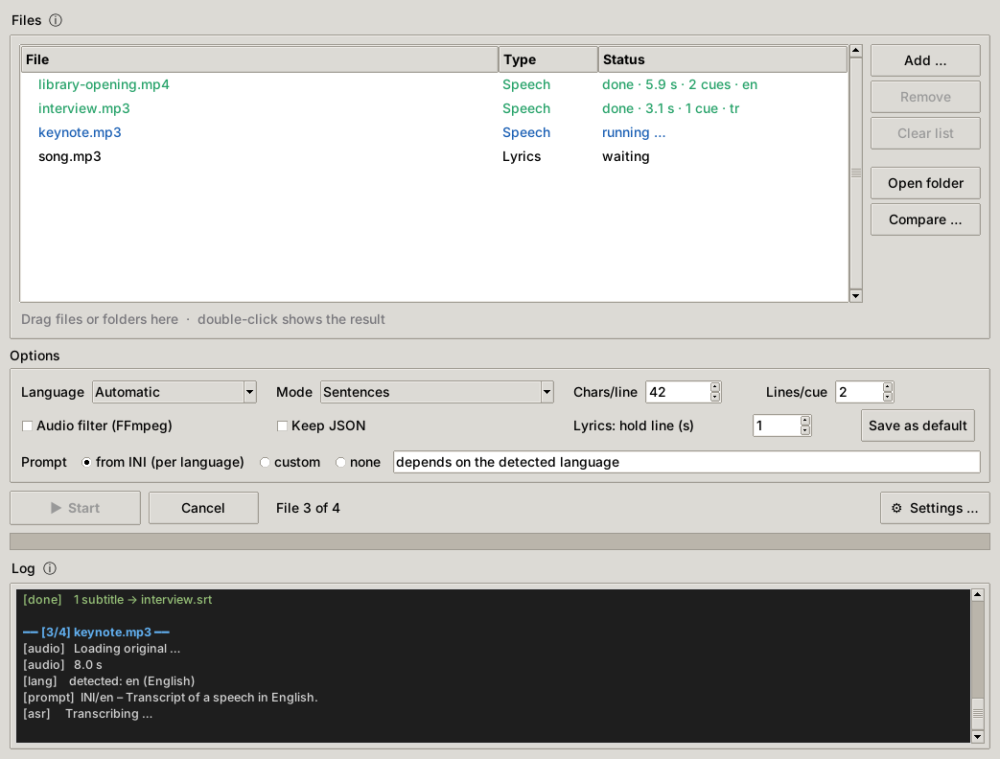
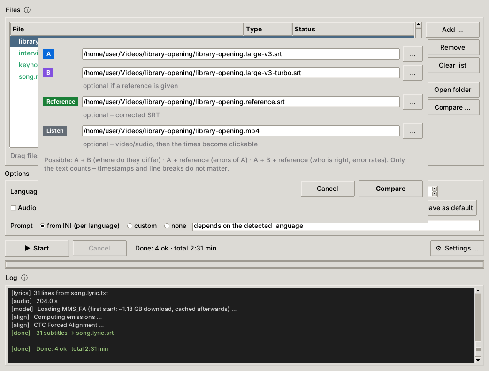
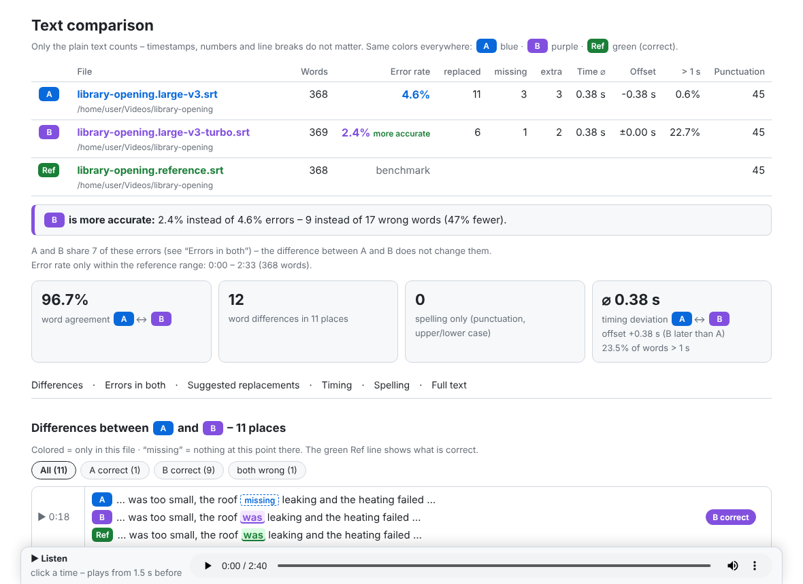
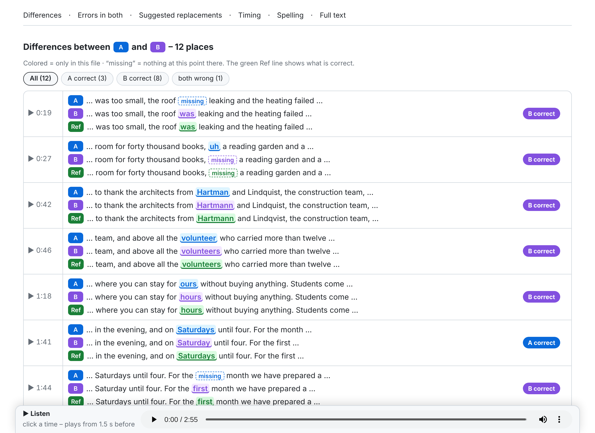
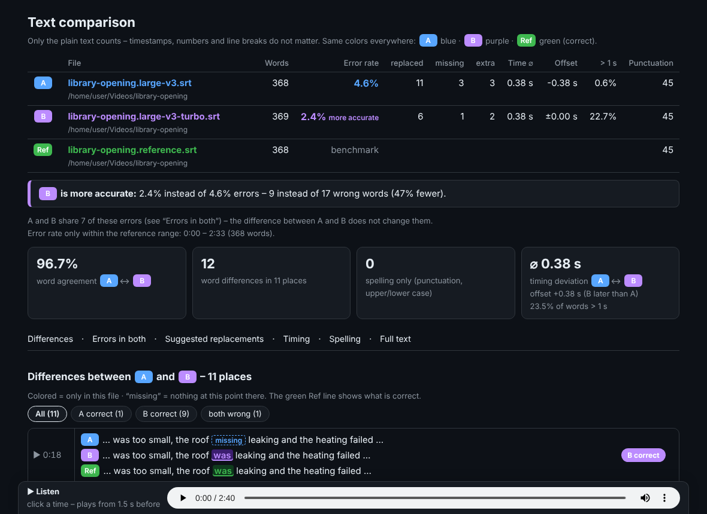
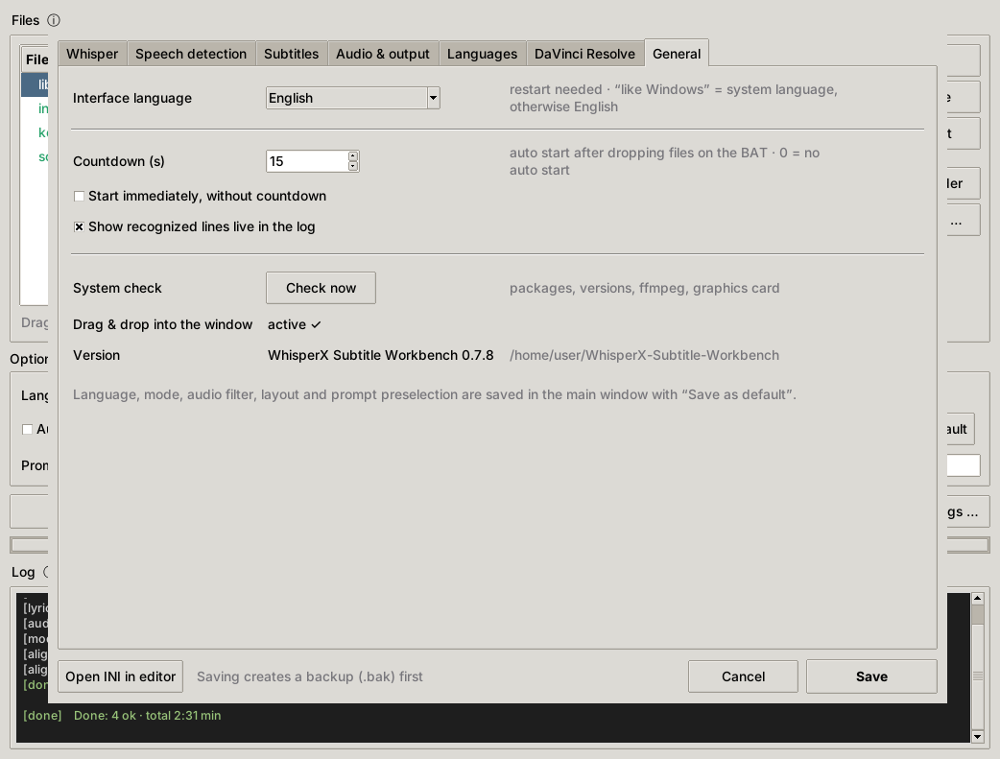

# WhisperX Subtitle Workbench

[English](README.md) · **Deutsch** · [Türkçe](README.tr.md)

**Version 0.2.0** · [Änderungen](CHANGELOG.md)

Ein Windows-Programm für **Untertitel aus Reden** (WhisperX), **Liedtexte passend zum Song** (MMS_FA) und den **Wort-für-Wort-Vergleich von Transkripten**. Die Oberfläche gibt es auf Deutsch, Englisch und Türkisch.



Du ziehst Video- oder Audiodateien ins Fenster, und das Tool erstellt `.srt`-Untertitel. Die Untertitel-Regeln sind auf gute Lesbarkeit abgestimmt: Zeilenlänge, verwaiste Wörter, Dangling-Wörter, Pausen, Mindest- und Höchst-Standzeit sowie Lesegeschwindigkeit. Ein Lücken-Check findet laute Stellen ohne Text. Der Vergleichsbericht zeigt, welches Modell oder welche Einstellung besser erkennt, mit Fehlerquote, Zeitabweichung und Zeitstempeln, die beim Anklicken die Stelle abspielen.

> Die Bildschirmfotos zeigen die englische Oberfläche; unter *Einstellungen → Allgemein* lässt sie sich auf Deutsch umstellen.

---

## Inhalt

- [Funktionen](#funktionen)
- [Voraussetzungen und Abhängigkeiten](#voraussetzungen-und-abhängigkeiten) ← **vor der Installation lesen**
- [Installation (Windows)](#installation-windows)
- [Sicher aktualisieren](#sicher-aktualisieren)
- [Bedienung](#bedienung)
- [Transkripte vergleichen](#transkripte-vergleichen)
- [Einstellungen](#einstellungen)
- [Sprache der Oberfläche und Übersetzungen](#sprache-der-oberfläche-und-übersetzungen)
- [Kommandozeile](#kommandozeile)
- [Fehlersuche](#fehlersuche)
- [Aufbau des Projekts](#aufbau-des-projekts)
- [Lizenz und Danksagung](#lizenz-und-danksagung)

---

## Funktionen

- **Rede → SRT** mit WhisperX (faster-whisper + Wort-Zeitstempel). Die Modelle bleiben zwischen den Dateien geladen, die zweite Datei startet also ohne Ladezeit.
- **Drei Untertitel-Modi:**
  - **Satzweise:** ganze Sätze mit Zeichenlimit sowie Regeln für verwaiste Wörter (Orphans), Dangling-Wörter, Pausen und maximale Standzeit.
    Kurze Untertitel stehen eine Mindestzeit, und die Lesegeschwindigkeit (Zeichen pro Sekunde) wird geprüft. Dafür wird nur das Ende eines Untertitels in die Pause danach verlängert; der Text ändert sich nie.
    Der Zeilenausgleich verteilt die Wörter gleichmäßig auf die Zeilen (`müssen und / zwar ohne Ende` statt `müssen und zwar ohne / Ende`), wenn möglich mit Umbruch nach einem Komma.
    Abkürzungen und Datumsangaben bleiben zusammen: `Dr. Müller`, `z. B. gestern` und `6. November` werden nie auf zwei Zeilen oder zwei Untertitel verteilt. Die Liste je Sprache steht unter *Einstellungen → Sprachen*.
  - **Wort-für-Wort:** ein Untertitel pro Wort, z.B. für Karaoke-Effekte.
  - **Raw:** die WhisperX-Abschnitte unverändert.
- **Sprache pro Datei:** Die Sprache wird pro Datei erkannt, oder du legst sie fest. Jede Sprache hat ihren eigenen Prompt, Füllwörter, Dangling-Wörter, Ersetzungen und optional ein eigenes Modell (z.B. ein türkisches Fine-Tune).
- **Lyrics-Modus:** Liegt `lied.lyric.txt` neben `lied.mp3`, wird jede Zeile des Liedtexts zeitlich auf das Audio ausgerichtet. Das läuft über Forced Alignment (MMS_FA + uroman) und funktioniert für jede Sprache.
- **JSON → SRT:** Du kannst das WhisperX-Ergebnis behalten und die Untertitel später in Sekunden mit anderem Layout neu bauen.
- **Lücken-Check:** Findet nach jeder Transkription laute, stimmähnliche Stellen ohne Text, also verschluckte Sprache. Dazu wird eine eigene Untertiteldatei geschrieben, mit der du jede Stelle direkt anspringen kannst.
- **Vergleichsbericht** (HTML): A gegen B, A gegen Referenz oder A gegen B gegen Referenz.
  - Zeigt bei jedem Unterschied, wer recht hat.
  - Zeigt die Fehlerquote (WER) jeder Datei und die Fehler, die beide gleich machen.
  - Schlägt Ersetzungen vor.
  - Zeigt Zeitabweichungen.
  - Jede Zeit im Bericht ist anklickbar und spielt das Audio ab dieser Stelle.
- **Systemprüfung** bei jedem Start: Sie listet Python, alle Pakete samt Versionen, ffmpeg, die Modelle und die Grafikkarte auf und sagt dir, welche Funktion ausfallen würde.
- **Komfort:**
  - Drag & Drop auf die BAT-Datei oder ins Fenster. Ein zweiter Start reicht seine Dateien an das schon offene Fenster weiter.
  - Ein Countdown startet die Verarbeitung automatisch.
  - Erkannte Zeilen erscheinen live im Protokoll.
  - Tooltips erklären jede Option.
  - Der Einstellungsdialog schreibt nur geänderte Werte und lässt die Kommentare in der INI stehen.
- **Mehrsprachig:** Deutsch, Englisch und Türkisch. Weitere Sprachen fügst du hinzu, indem du eine einzige JSON-Datei kopierst (siehe [Sprache der Oberfläche und Übersetzungen](#sprache-der-oberfläche-und-übersetzungen)).

---

## Voraussetzungen und Abhängigkeiten

> **Der wichtigste Teil dieser Anleitung.** WhisperX baut auf PyTorch, CTranslate2, pyannote und mehreren kleineren Paketen auf, und die hängen jeweils von **exakten** Versionen der anderen ab. Ein unbedachtes `pip install` kann still dein CUDA-PyTorch durch eine CPU-Version oder eine unpassende Version ersetzen. Das Tool scheitert dann auf schwer verständliche Weise. Wenn du dich an die Reihenfolge unten hältst, bekommst du eine Kombination, die nachweislich funktioniert.

### Was du brauchst

| Was | Getestet mit | Hinweis |
|---|---|---|
| Windows | Windows 10/11, 64 Bit | Die Oberfläche ist Tkinter; der Kern läuft auch unter Linux, der BAT-Starter ist für Windows |
| NVIDIA-Grafikkarte | RTX 5080 (16 GB) | ≥ 8 GB Grafikspeicher empfohlen für `large-v3`. RTX 20xx oder neuer; GTX 10xx und älter brauchen einen anderen PyTorch-Build (Schritt 4). Mit der CPU geht es, aber sehr langsam |
| NVIDIA-Treiber | R570 oder neuer | Nötig für die CUDA-12.8-Pakete. Es reicht der Treiber; das CUDA-Toolkit musst du **nicht** installieren |
| Python | **3.10.11** (WhisperX erlaubt 3.10–3.13) | Von python.org, mit „tcl/tk and IDLE“ (Tkinter), das ist standardmäßig angehakt. 3.10.11 ist die letzte 3.10-Version mit Windows-Installer. Python 3.10 bekommt seit Oktober 2026 keine Sicherheitsupdates mehr; die Paket-Kombination ist mit 3.10 getestet |
| ffmpeg | 6.x / 7.x | Eigenes Programm, kein pip-Paket. Jeder Full-Build, z.B. `winget install Gyan.FFmpeg` |
| Internet | nur beim ersten Start | Whisper-Modell (~3 GB), Alignment-Modelle je Sprache, MMS_FA (~1,2 GB für Lyrics) |

Ein Hugging-Face-Token ist nicht nötig, weil das Tool keine Sprechertrennung (Diarization) benutzt.

### Die getestete Paket-Kombination

Diese Versionen laufen produktiv zusammen (Python 3.10, Windows 11, RTX 5080):

| Paket | Version | Warum genau diese |
|---|---|---|
| `torch` | **2.8.0+cu128** | WhisperX 3.8 verlangt `torch~=2.8.0` (nur 2.8.x). **Muss** vom PyTorch-CUDA-Index kommen; das PyPI-Paket für Windows ist eine reine CPU-Version. RTX 50xx (Blackwell, sm_120) braucht einen cu128-Build oder neuer |
| `torchaudio` | **2.8.0+cu128** | Muss **genau** dieselbe Version und denselben CUDA-Build haben wie torch. Wird für Lyrics (MMS_FA) gebraucht |
| `torchvision` | 0.23.0 | Gehört zu torch 2.8 (von WhisperX verlangt) |
| `torchcodec` | 0.7.0 | WhisperX verlangt `<0.8`, pyannote-audio 4 verlangt `≥0.7`, also passt nur 0.7.x. Gehört zu torch 2.8 |
| `whisperx` | **3.8.5** | Das Tool ist mit 3.8.x getestet; die Systemprüfung warnt unter 3.8 |
| `faster-whisper` | 1.2.1 | Verlangt `ctranslate2 <5` |
| `ctranslate2` | 4.7.1 | Ab **4.5** wird CUDA 12 + **cuDNN 9** benutzt, das torch 2.8 mitbringt. Bis 4.4 wird cuDNN 8 erwartet, das scheitert |
| `pyannote-audio` | 4.0.4 | Spracherkennung (VAD). Verlangt torch ≥ 2.8 und torchcodec ≥ 0.7 |
| `numpy` | ≥ 2.1 (installiert WhisperX) | Pakete, die `numpy<2` brauchen, passen nicht ins selbe venv |
| `uroman` | 1.3.1.1 | Nur für den Lyrics-Modus (Umschrift für das Alignment) |
| `tkinterdnd2` | 0.6.3, *optional* | Drag & Drop direkt ins Fenster. Hat keine Abhängigkeiten; mit `--no-deps` installieren |

### Wie die Abhängigkeiten zusammenhängen

```
torch 2.8.0+cu128 ──┬── torchaudio 2.8.0+cu128   (immer gleiche Version + gleicher CUDA-Build)
                    ├── torchvision 0.23.0
                    ├── torchcodec 0.7.x          (WhisperX <0.8, pyannote ≥0.7)
                    └── cuDNN 9 (mitgeliefert) ── ctranslate2 ≥4.5 ── faster-whisper 1.2.x
                                                                    │
whisperx 3.8.x ── verlangt torch~=2.8.0, torchaudio~=2.8.0, torchvision~=0.23.0,
                  torchcodec <0.8, ctranslate2 ≥4.5, faster-whisper ≥1.2, pyannote-audio ≥4, numpy ≥2.1
```

### Bekannte Wege, die Installation kaputt zu machen

| Was passiert | Typisches Zeichen | Vorbeugen / beheben |
|---|---|---|
| `pip install whisperx` **vor** torch | torch kommt von PyPI als CPU-Version → Systemprüfung: „torch ist eine Version ohne CUDA“ | Immer zuerst torch vom PyTorch-Index installieren (Schritt 4 unten) |
| `pip install -U whisperx` oder ein anderes Paket zieht ein anderes torch nach | torch/torchaudio ersetzt, Lyrics oder VAD scheitern, CUDA weg | Erst `pip install --dry-run …` und abbrechen, wenn sich `torch`, `torchaudio`, `torchvision`, `torchcodec` oder `ctranslate2` ändern würde |
| torch und torchaudio aus verschiedenen Versionen oder Builds | Importfehler in torchaudio (`DLL load failed`, `WinError 127`), Lyrics scheitern; die Systemprüfung warnt | Beide zusammen mit gleicher Version und `--index-url` neu installieren |
| `ctranslate2` < 4.5 | `Could not locate cudnn_ops_infer64_8.dll` | ctranslate2 ≥ 4.5 benutzen (getestet: 4.7.1) |
| Ein älterer CUDA-Build (cu121/cu124) auf einer RTX 50xx | `no kernel image is available for execution on the device` | Den cu128-Build benutzen |
| Der cu128-Build auf einer GTX 10xx, GTX 9xx oder Titan V | Warnung „… CUDA capability sm_61 is not compatible …“, danach `no kernel image is available` | Den cu126-Build benutzen (Schritt 4) |
| `pip install -r requirements.txt` in einem **vorhandenen** venv mit anderem torch | pip ersetzt dieses torch durch die CPU-Version von PyPI, und das dort installierte WhisperX läuft auch nicht mehr | Nie in ein vorhandenes venv installieren; einen neuen Ordner mit eigenem venv nehmen |
| Ein anderes KI-Tool ins selbe venv installiert | anderes torch oder `numpy<2` → verschiedenste Fehler | Anderen Tools ein eigenes venv geben |
| Python ohne Tkinter | Das Tool meldet „Tkinter fehlt“ | Python-Installer → Modify → „tcl/tk and IDLE“ |

---

## Installation (Windows)

Alle Befehle sind für `cmd.exe`. Der Beispielordner ist `C:\WhisperX-Subtitle-Workbench`. Jeder andere Ordner geht auch, solange `venv` **darin** liegt, denn `Whisper_Tool.bat` sucht es dort.

**1. Python 3.10.11 installieren** von [python.org](https://www.python.org/downloads/release/python-31011/) (*Windows installer (64-bit)*). Neuere 3.10-Versionen gibt es nur als Quellcode, ohne Installer.

- „tcl/tk and IDLE“ angehakt lassen.
- Benutzt du schon ein anderes Python, „Add python.exe to PATH“ **nicht** anhaken. Diese Anleitung braucht es nicht (`py -3.10`), und dein anderes Python bleibt das Standard-Python.

**2. ffmpeg installieren**, zum Beispiel:

```bash
winget install Gyan.FFmpeg
```

Danach ein **neues** `cmd`-Fenster öffnen; das Fenster, in dem winget lief, kennt den neuen Pfad noch nicht. Du kannst auch einen Build nach `C:\ffmpeg` entpacken und später `C:\ffmpeg\bin\ffmpeg.exe` unter *Einstellungen → Audio & Ausgabe* eintragen.

**3. Die Workbench holen**, mit git oder als ZIP von GitHub herunterladen und entpacken:

```bash
git clone https://github.com/fardem/WhisperX-Subtitle-Workbench C:\WhisperX-Subtitle-Workbench
```

Das ZIP entpackt in einen Ordner `WhisperX-Subtitle-Workbench-main`. Benenne ihn in `WhisperX-Subtitle-Workbench` um oder passe den Pfad in den Befehlen unten an.

**4. venv anlegen und PyTorch mit CUDA installieren.** Dieser Schritt kommt zuerst und ist der entscheidende.

Zuerst den Treiber prüfen. `nvidia-smi` zeigt oben die *Driver Version*; sie sollte 570 oder höher sein:

```bash
nvidia-smi
```

```bash
cd /d C:\WhisperX-Subtitle-Workbench
```

```bash
py -3.10 -m venv venv
```

```bash
venv\Scripts\python.exe -m pip install --upgrade pip
```

```bash
venv\Scripts\python.exe -m pip install torch==2.8.0 torchaudio==2.8.0 torchvision==0.23.0 --index-url https://download.pytorch.org/whl/cu128
```

> **Welcher Build für welche Grafikkarte:**
> - RTX 50xx braucht `cu128`.
> - RTX 20xx bis 40xx laufen mit `cu128`.
> - GTX 10xx, GTX 9xx und Titan V unterstützt der cu128-Build **nicht mehr**. Am Ende des Befehls oben `cu126` statt `cu128` schreiben; Schritt 6 zeigt dann `2.8.0+cu126 12.6 True`. GTX-10xx-Karten haben außerdem kein schnelles float16, deshalb *Einstellungen → Whisper → Genauigkeit* auf `int8` oder `float32` stellen.
>
> Getestet ist nur der cu128-Build auf einer RTX 5080.

**5. WhisperX und den Rest installieren**, mit den getesteten Versionen:

```bash
venv\Scripts\python.exe -m pip install -r requirements.txt -c constraints.txt
```

`requirements.txt` sagt, *was* installiert wird. `constraints.txt` legt **alle** Pakete, auch die rund 100, die indirekt mitkommen, auf genau die Versionen der getesteten Installation fest. Eine neue Installation sieht deshalb genauso aus wie die getestete, auch wenn ein Paket später eine neue Version herausbringt. pip behält das vorhandene `torch 2.8.0+cu128`, weil es WhisperX' `torch~=2.8.0` schon erfüllt.

**6. Die Installation prüfen:**

```bash
venv\Scripts\python.exe -c "import torch; print(torch.__version__, torch.version.cuda, torch.cuda.is_available())"
```

Erwartet wird `2.8.0+cu128 12.8 True`. Danach das venv auf Konflikte prüfen:

```bash
venv\Scripts\python.exe -m pip check
```

**7. Optional: Drag & Drop direkt ins Fenster.** Das geht auch später mit einem Klick unter *Einstellungen → Allgemein*:

```bash
venv\Scripts\python.exe -m pip install --no-deps tkinterdnd2==0.6.3
```

**8. Starten:** `Whisper_Tool.bat`. Beim ersten Start legt das Tool `whisper_tool.ini` aus `whisper_tool.example.ini` an und führt die Systemprüfung durch. Jede Zeile der Prüfung sollte grün sein.

**Desktop-Verknüpfung:** Rechtsklick auf `Whisper_Tool.bat` → *Verknüpfung erstellen* → die Verknüpfung auf den Desktop ziehen. Du kannst Dateien und Ordner auf die Verknüpfung ziehen.

### Ein vorhandenes WhisperX-venv benutzen

Wenn du schon ein funktionierendes WhisperX-venv hast, z.B. in `C:\WhisperX\venv`, kopiere die Dateien dieses Repositorys nach `C:\WhisperX`, neben den Ordner `venv`. Es wird nichts installiert; das Tool benutzt nur die Pakete, die schon da sind. Vor dem Kopieren das Tool schließen und die Dateien direkt nach `C:\WhisperX` entpacken, nicht in einen Unterordner.

> **In diesem venv kein `pip install` ausführen, vor allem nicht `requirements.txt`.** Ist dort ein anderes torch als 2.8.x installiert, ersetzt pip es durch die CPU-Version von PyPI, und dein vorhandenes WhisperX läuft auch nicht mehr. Meldet die Systemprüfung WhisperX als zu alt, installiere die Workbench lieber in einen **neuen Ordner** mit eigenem venv (Schritte 1–8). Deine alte Installation bleibt dann unberührt.

---

## Sicher aktualisieren

- **Zuerst das Tool schließen.** Die laufende Version steht in der Titelleiste (z.B. *WhisperX Subtitle Workbench 0.2.0*), in der ersten Zeile des Protokolls und unter *Einstellungen → Allgemein*. Ist beim Start der neuen Version noch ein älteres Fenster offen, warnt die neue Version, statt deine Dateien still an das alte Fenster weiterzugeben.
- **Die Workbench selbst:** `git pull`, oder die neuen Dateien über die alten kopieren. Deine Einstellungen stehen in `whisper_tool.ini`. Diese Datei gehört nicht zum Repository, ein Update überschreibt sie also nie. Neue Optionen bekommen automatisch Standardwerte.
- **Python-Pakete:** Nur aktualisieren, wenn du etwas Neues brauchst. So geht es sicher:

1. **Das venv sichern:** das Tool schließen und den ganzen Ordner `venv` kopieren, z.B. nach `venv-backup`. Das ist die eigentliche Sicherung. Zum Zurückholen `venv` löschen und `venv-backup` wieder in `venv` umbenennen. Sie funktioniert nur am ursprünglichen Pfad.

2. Den aktuellen Stand notieren, damit du später nachsehen kannst:

   ```bash
   venv\Scripts\python.exe -m pip freeze > requirements-working.txt
   ```

   Die Liste enthält `torch==2.8.0+cu128`, und das gibt es auf PyPI nicht. Um daraus ein **neues** venv zu installieren, braucht pip zusätzlich den PyTorch-Index:

   ```bash
   venv\Scripts\python.exe -m pip install -r requirements-working.txt --extra-index-url https://download.pytorch.org/whl/cu128
   ```

3. Zuerst einen Probelauf machen. Er installiert nichts:

   ```bash
   venv\Scripts\python.exe -m pip install --dry-run -U whisperx
   ```

4. Steht in der Ausgabe des Probelaufs unter „Would install“ `torch`, `torchaudio`, `torchvision`, `torchcodec` oder `ctranslate2`, **abbrechen**. Dieses Update würde die Kombination zerstören.

---

## Bedienung

| Du ziehst … | Das Tool macht … | Ergebnis |
|---|---|---|
| eine Video-/Audiodatei (`.mp4 .mkv .mp3 .wav .m4a …`) | Transkription mit WhisperX | `<name>.srt` |
| eine Mediendatei mit `<name>.lyric.txt` daneben | Lyrics-Alignment (eine Liedzeile pro Zeile, UTF-8) | `<name>.lyric.srt` |
| eine WhisperX-`.json` (gespeichert mit „JSON behalten“) | baut nur die Untertitel neu | `<name>.srt` |
| einen Ordner | alle Mediendateien darin | |

- **Start** verarbeitet die markierten Dateien. Ist nichts markiert, verarbeitet es alle Dateien, die noch nicht fertig sind. Ist alles fertig, verarbeitet es alle nochmal, z.B. mit anderem Layout.
- **Sprache:**
  - *Automatisch* erkennt die Sprache pro Datei, anhand der ersten 30 Sekunden.
  - Eine fest eingestellte Sprache ist zuverlässiger. Wähle sie, wenn die Aufnahme mit Musik oder einem Intro beginnt.
- **Prompt:** ein kurzer Hinweis an Whisper mit seltenen Namen und Begriffen in der gewünschten Schreibweise. Schreibe ihn in der Sprache des Audios. Den Prompt je Sprache stellst du unter *Einstellungen → Sprachen* ein.
- **Lücken-Check:**
  - Dateien mit verdächtigen Lücken bekommen in der Liste den Status „⚠ Lücken“.
  - Die Stellen erscheinen gelb im Protokoll.
  - Sie werden außerdem als `<name>.luecken.srt` gespeichert. Der Dateiname folgt der Oberflächensprache: `.gaps.srt` auf Englisch, `.bosluklar.srt` auf Türkisch. In VLC oder Subtitle Edit als zweite Untertitelspur laden, um jede Stelle anzuspringen.
- **Maus auf ein Bedienelement halten** zeigt eine ausführliche Erklärung.

---

## Transkripte vergleichen

Mit **Vergleichen …** in der Dateiliste testest du Modelle und Einstellungen. Nur der reine Text zählt; Zeitstempel und Zeilenumbrüche werden ignoriert.



| Dateien | Was du erfährst |
|---|---|
| **A + B** | Wo sich zwei Transkripte unterscheiden, z.B. zwei Modelle, Beams oder Prompts |
| **A + Referenz** | Alle Fehler von A. Die Referenz ist eine von Hand korrigierte SRT; 5–10 korrigierte Minuten reichen |
| **A + B + Referenz** | Wer bei jedem Unterschied recht hat, die Fehlerquote beider Dateien, die gemeinsamen Fehler und Vorschläge für Ersetzungen |

Die Farben sind überall gleich: **A blau, B violett, Referenz grün (richtig)**. Nichts wird durchgestrichen; *fehlt* markiert eine Stelle, an der in einer Datei nichts steht.





Der Bericht enthält außerdem:
- **Zeit:** die typische Abweichung und den mittleren Versatz, immer angezeigt. Abschnitte, in denen mehrere Wörter am Stück mehr als 1 s daneben liegen, werden einzeln aufgeführt.
- **Fehler in beiden:** Fehler, die nur ein Prompt oder eine Ersetzung behebt.
- **Ersetzungs-Vorschläge:** `falsch = richtig`-Zeilen mit Kopierknopf, fertig für *Einstellungen → Sprachen → Ersetzungen*.
- **Nur Schreibweise:** Unterschiede bei Satzzeichen oder Groß-/Kleinschreibung, die nicht als Fehler zählen.
- **Volltext:** der ganze Text mit allen Abweichungen markiert.

**Anhören:** Gibst du das Video oder Audio mit an, legt das Tool neben den Bericht eine kleine Tonspur (`.m4a`). Jede Zeit im Bericht ist dann anklickbar und spielt ab 1,5 s vor der Stelle. Bericht und `.m4a`-Datei zusammen lassen.

Tipp: Stelle *Endung Rede* auf `.{model}.srt` (*Einstellungen → Audio & Ausgabe*). Dann schreibt jedes Modell seine eigene SRT, und du kannst sie leicht vergleichen.

Der Bericht folgt dem hellen/dunklen Modus deines Systems:



---

## Einstellungen

- **Hauptfenster:** Sprache, Modus, Layout, Audiofilter und Prompt. *Als Standard speichern* legt sie in der INI ab.
- **Einstellungen …** hat sechs Reiter: Whisper, Spracherkennung, Untertitel, Audio & Ausgabe, Sprachen und Allgemein. *Speichern* schreibt nur die geänderten Werte in `whisper_tool.ini`, legt vorher eine `.bak`-Sicherung an und lässt alle Kommentare stehen.
- `whisper_tool.ini` kannst du auch von Hand bearbeiten. Jeder Wert ist kommentiert; die Vorlage ist `whisper_tool.example.ini`.

Änderungen gelten beim nächsten Start, ohne das Fenster zu schließen. Die Modelle werden nur neu geladen, wenn sich ein Modell-Parameter ändert.

---

## Sprache der Oberfläche und Übersetzungen

Oberfläche, Protokoll und Vergleichsbericht gibt es auf **Deutsch, Englisch und Türkisch**.



- *Einstellungen → Allgemein → Sprache der Oberfläche*. Die Vorgabe „wie Windows“ nimmt die Systemsprache, wenn es dafür eine Sprachdatei gibt, sonst Englisch. Nach einer Änderung bietet das Tool an, das Fenster neu zu starten.
- In der INI: `[System] ui_language = auto | en | de | tr`.

**Eine Sprache hinzufügen:**
1. `lang/en.json` nach `lang/<code>.json` kopieren, z.B. `lang/fr.json`.
2. Die Werte übersetzen und `"_meta" → "name"` setzen. Platzhalter wie `{n}` und `{path}` unverändert lassen.
3. Das Tool neu starten. Die neue Sprache erscheint automatisch in der Liste.

Fehlende Einträge fallen auf Englisch zurück, eine halb fertige Übersetzung legt das Tool also nie lahm. Pull Requests mit neuen Sprachen sind willkommen.

---

## Kommandozeile

Ohne Fenster, z.B. für eine geplante Aufgabe, mit den Standardwerten aus `[Menu]` der INI:

```bash
venv\Scripts\python.exe whisper_tool.py --nogui datei1.mp4 datei2.mp3
```

Einen Vergleichsbericht ohne Fenster erstellen:

```bash
venv\Scripts\python.exe wt_compare.py A.srt B.srt referenz.srt --media video.mp4
```

```bash
venv\Scripts\python.exe wt_compare.py A.srt --ref referenz.srt --lang de
```

---

## Fehlersuche

| Problem | Lösung |
|---|---|
| Nach einem Update ist noch die alte Oberfläche zu sehen (Titel „Whisper Tool“) | Ein altes Fenster ist noch offen und hat den Start übernommen. Schließen – ist es nicht sichtbar, im Task-Manager `pythonw.exe` beenden – und neu starten |
| Das Tool startet nicht | Ein Meldungsfenster zeigt die Ursache. Derselbe Text steht in `whisper_tool_error.log` |
| Eine Zeile der Systemprüfung ist rot | Sie nennt das fehlende Teil und welche Funktion betroffen ist. Siehe [Bekannte Wege, die Installation kaputt zu machen](#bekannte-wege-die-installation-kaputt-zu-machen) |
| „torch ist eine Version ohne CUDA“ | torch wurde von PyPI installiert. Schritt 4 der Installation wiederholen |
| Text fehlt an leisen Stellen | Den Lücken-Check ansehen. Dann den *Onset* senken oder *silero* testen (*Einstellungen → Spracherkennung*) |
| Falsche Sprache für die ganze Datei | Die Sprache festlegen statt *Automatisch*; Musik oder ein Intro am Anfang können die Erkennung täuschen |
| Prompt-Wörter tauchen in Stille oder Musik auf | Den Prompt kürzen oder für diese Datei *keiner* wählen |
| Drag & Drop ins Fenster geht nicht | *Einstellungen → Allgemein → Drag & Drop → Aktivieren …*, dann das Fenster neu starten. Auf die BAT ziehen geht immer |

---

## Aufbau des Projekts

| Datei | Aufgabe |
|---|---|
| `whisper_tool.py` | Oberfläche (Tkinter), Einstellungsdialog, Vergleichsdialog, Konsolenmodus |
| `wt_core.py` | Audio laden, WhisperX, Lyrics-Alignment, Untertitel-Regeln, Lücken-Check, Systemprüfung, INI-Schreiber |
| `wt_compare.py` | Wort-für-Wort-Vergleich und HTML-Bericht (auch allein benutzbar) |
| `wt_i18n.py` | Lädt die Sprachdateien |
| `wt_version.py` | Name und Versionsnummer (in Titelleiste, Protokoll und Bericht) |
| `lang/*.json` | Alle Texte von Oberfläche, Protokoll und Bericht (en, de, tr) |
| `whisper_tool.example.ini` | Einstellungs-Vorlage; wird beim ersten Start zu `whisper_tool.ini` kopiert |
| `Whisper_Tool.bat` | Starter: doppelklicken oder Dateien darauf ziehen |
| `requirements.txt` | Die getesteten Paketversionen (torch zuerst installieren!) |
| `constraints.txt` | Exakte Versionen aller Pakete der getesteten Installation (`pip freeze`), wird in Schritt 5 mit `-c` benutzt |
| `tests/` | Automatische Tests (pytest). Sie brauchen weder Grafikkarte noch WhisperX und laufen bei jedem Push auf GitHub |

---

## Lizenz und Danksagung

[MIT-Lizenz](LICENSE) © 2026 fardem

Dieses Tool baut auf der Arbeit anderer auf:
- [WhisperX](https://github.com/m-bain/whisperX)
- [faster-whisper](https://github.com/SYSTRAN/faster-whisper) und [CTranslate2](https://github.com/OpenNMT/CTranslate2)
- [OpenAI Whisper](https://github.com/openai/whisper)
- [pyannote.audio](https://github.com/pyannote/pyannote-audio)
- [PyTorch / torchaudio](https://pytorch.org/), einschließlich der Forced-Alignment-Pipeline MMS_FA
- [uroman](https://github.com/isi-nlp/uroman)
- [FFmpeg](https://ffmpeg.org/)

Für diese Pakete gelten ihre eigenen Lizenzen. Die Bildschirmfotos zeigen erfundene Demo-Inhalte.
