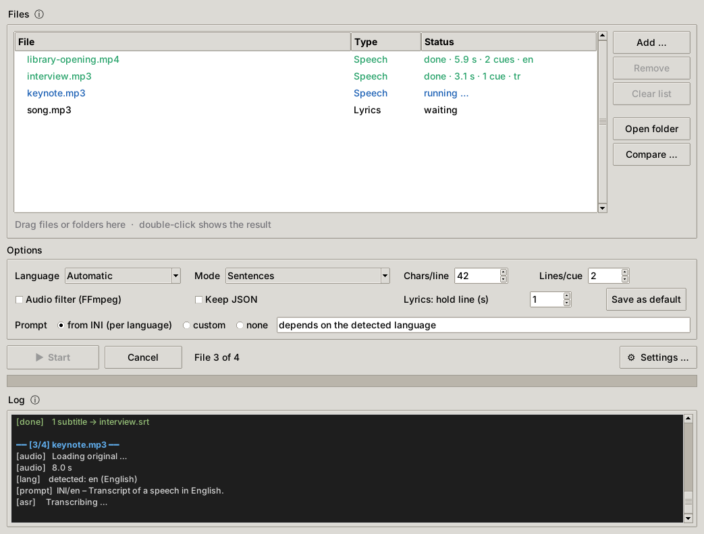
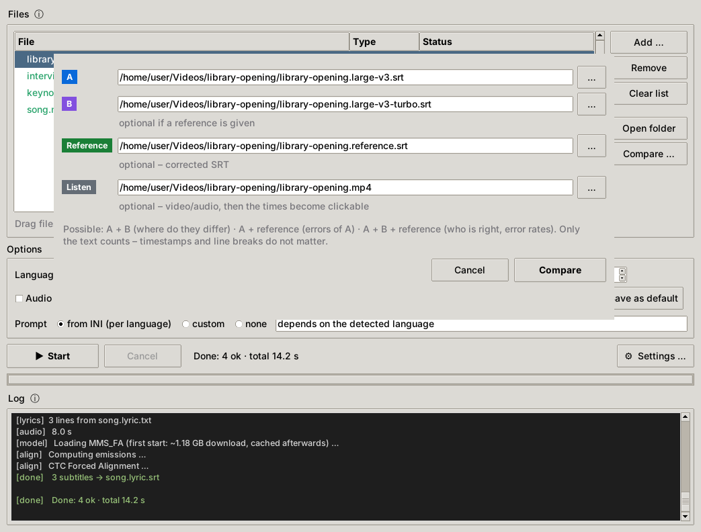
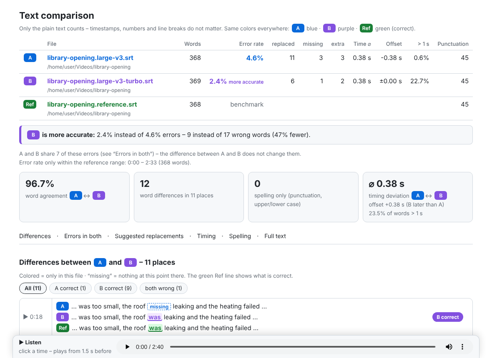
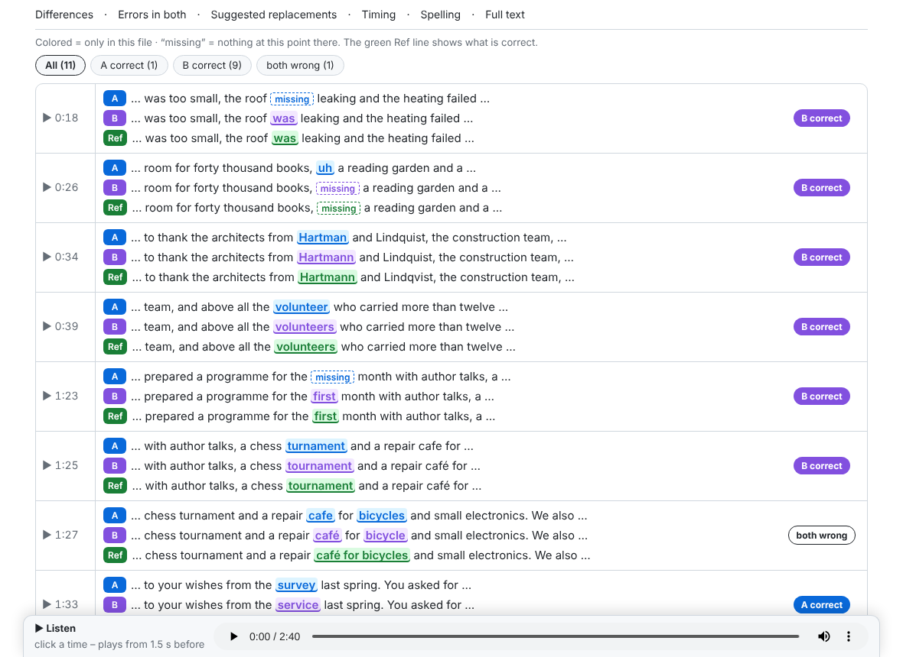
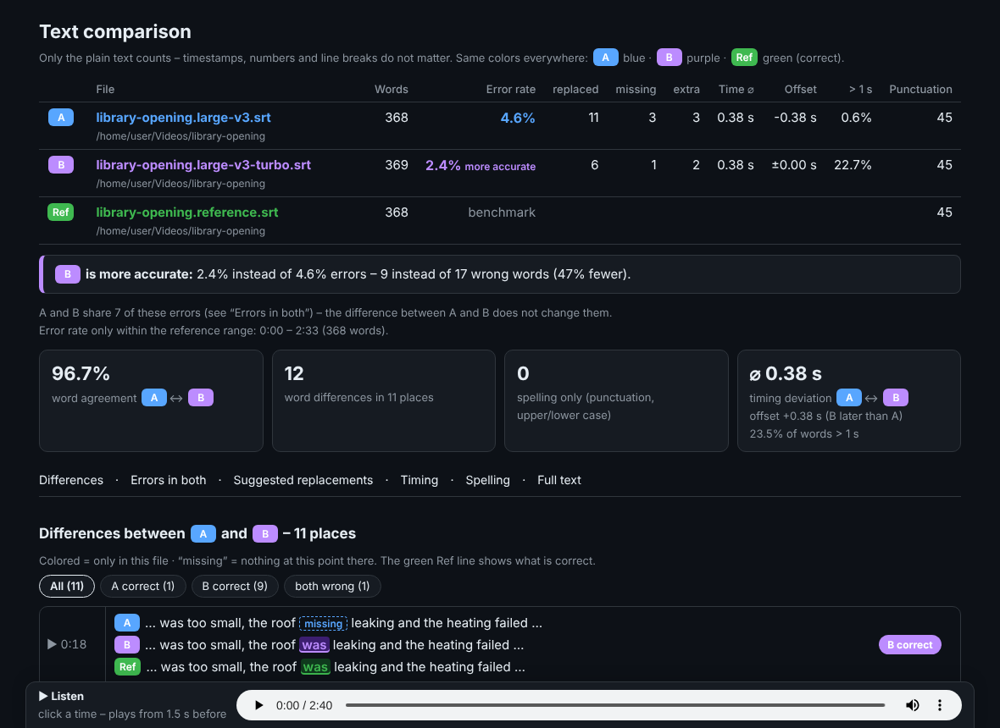
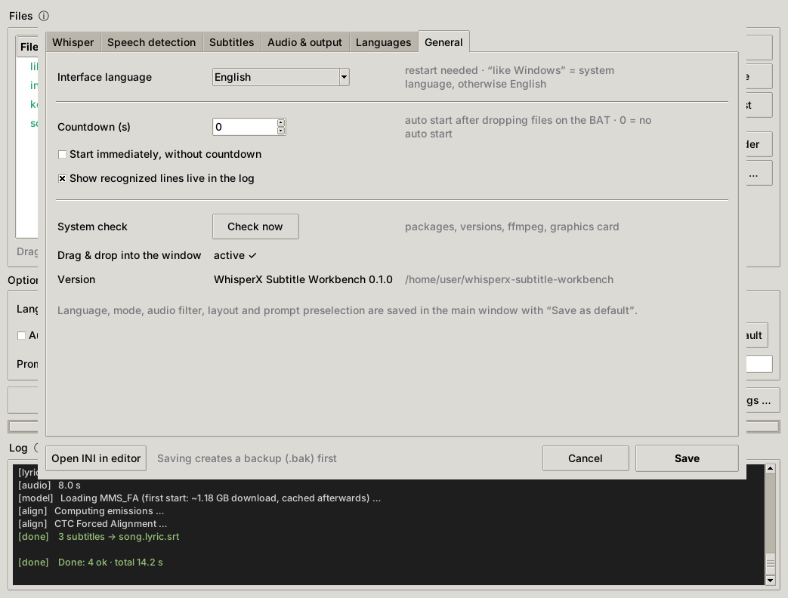

# WhisperX Subtitle Workbench

**English** · [Deutsch](README.de.md) · [Türkçe](README.tr.md)

**Version 0.1.0** · [Changelog](CHANGELOG.md)

A Windows desktop tool for **subtitles from speeches** (WhisperX), **lyrics aligned to songs** (MMS_FA) and **comparing transcripts word by word**, with a user interface in English, German and Turkish.



You drop video or audio files into the window, and the tool creates `.srt` subtitles. The subtitle rules are tuned for readable output: line length, orphan words, dangling words, pauses and maximum display time. A gap check finds loud passages that got no text. The comparison report shows which model or setting recognizes better, with error rates, timing deviations and clickable audio.

---

## Contents

- [Features](#features)
- [Requirements and dependencies](#requirements-and-dependencies) ← **read this before installing**
- [Installation (Windows)](#installation-windows)
- [Updating safely](#updating-safely)
- [Usage](#usage)
- [Comparing transcripts](#comparing-transcripts)
- [Settings](#settings)
- [Interface language and translations](#interface-language-and-translations)
- [Command line](#command-line)
- [Troubleshooting](#troubleshooting)
- [Project structure](#project-structure)
- [License and credits](#license-and-credits)

---

## Features

- **Speech → SRT** with WhisperX (faster-whisper + word timestamps). It keeps the models loaded between files, so the second file starts without loading time.
- **Three subtitle modes:**
  - **Sentences:** full sentences with a character limit and rules for orphans, dangling words, pauses and maximum display time.
  - **Word by word:** one cue per word, e.g. for karaoke effects.
  - **Raw:** the WhisperX segments unchanged.
- **Language per file:** the language is detected per file, or you set it. Each language has its own prompt, filler words, dangling words, replacements and optionally its own model (for example a Turkish fine-tune).
- **Lyrics mode:** put `song.lyric.txt` next to `song.mp3`, and every line of the song text is aligned to the audio. This uses forced alignment (MMS_FA + uroman) and works for any language.
- **JSON → SRT:** you can keep the WhisperX result and later rebuild the subtitles with a different layout in seconds.
- **Gap check:** after each transcription it finds loud, voice-like passages without text, i.e. speech that was missed. It writes an extra subtitle file you can load to jump to each passage.
- **Comparison report** (HTML): A vs. B, A vs. reference, or A vs. B vs. reference.
  - Shows who is right at every difference.
  - Shows the error rate (WER) of each file and the errors both files share.
  - Suggests replacements.
  - Shows timing deviations.
  - Every time in the report is clickable and plays the audio from that point.
- **System check** on every start: it lists Python, all packages with versions, ffmpeg, the models and the graphics card, and tells you which feature would fail.
- **Comfort:**
  - Drag & drop onto the BAT file or into the window. A second start hands its files to the open window.
  - A countdown starts processing automatically.
  - Recognized lines appear live in the log.
  - Tooltips explain every option.
  - A settings dialog writes only the changed values and keeps the comments in the INI.
- **Multilingual:** English, German and Turkish. You can add more languages by copying a single JSON file (see [Interface language and translations](#interface-language-and-translations)).

---

## Requirements and dependencies

> **The most important part of this README.** WhisperX sits on top of PyTorch, CTranslate2, pyannote and several smaller packages, and they depend on each other's **exact** versions. One careless `pip install` can quietly replace your CUDA build of PyTorch with a CPU build or a version that does not match. The tool then fails in ways that are hard to understand. Follow the order below and you will get a combination that is known to work.

### What you need

| What | Tested with | Notes |
|---|---|---|
| Windows | Windows 10/11, 64-bit | The UI is Tkinter; the core also runs on Linux, but the BAT starter is for Windows |
| NVIDIA graphics card | RTX 5080 (16 GB) | ≥ 8 GB VRAM recommended for `large-v3`. CPU works, but is very slow |
| NVIDIA driver | R570 or newer | Needed for CUDA 12.8 wheels. Only the driver is required; you do **not** need to install the CUDA toolkit |
| Python | **3.10** (3.10–3.13 allowed by WhisperX) | From python.org, with “tcl/tk and IDLE” (Tkinter), which is ticked by default |
| ffmpeg | 6.x / 7.x | A separate program, not a pip package. Any full build, e.g. `winget install Gyan.FFmpeg` |
| Internet | first run only | Whisper model (~3 GB), alignment models per language, MMS_FA (~1.2 GB for lyrics) |

No Hugging Face token is needed, because the tool does not use speaker diarization.

### The tested package set

These versions run together in production (Python 3.10, Windows 11, RTX 5080):

| Package | Version | Why exactly this one |
|---|---|---|
| `torch` | **2.8.0+cu128** | WhisperX 3.8 requires `torch~=2.8.0` (2.8.x only). **Must** come from the PyTorch CUDA index; the PyPI wheel for Windows is CPU-only. RTX 50xx (Blackwell, sm_120) needs a cu128 build or newer |
| `torchaudio` | **2.8.0+cu128** | Must be **exactly** the same version and CUDA build as torch. Used for lyrics (MMS_FA) |
| `torchvision` | 0.23.0 | Belongs to torch 2.8 (required by WhisperX) |
| `torchcodec` | 0.7.0 | WhisperX requires `<0.8`, pyannote-audio 4 requires `≥0.7`, so only 0.7.x fits. It belongs to torch 2.8 |
| `whisperx` | **3.8.5** | The tool is tested with 3.8.x; the system check warns below 3.8 |
| `faster-whisper` | 1.2.1 | Requires `ctranslate2 <5` |
| `ctranslate2` | 4.7.1 | Versions **≥ 4.5** use CUDA 12 + **cuDNN 9**, which torch 2.8 brings along. Versions ≤ 4.4 expect cuDNN 8 and fail |
| `pyannote-audio` | 4.0.4 | Speech detection (VAD). Requires torch ≥ 2.8 and torchcodec ≥ 0.7 |
| `numpy` | ≥ 2.1 (installed by WhisperX) | Packages that need `numpy<2` cannot live in the same venv |
| `uroman` | 1.3.1.1 | Lyrics mode only (romanizes text for the alignment) |
| `tkinterdnd2` | 0.6.3, *optional* | Drag & drop directly into the window. It has no dependencies; install it with `--no-deps` |

### How the dependencies are connected

```
torch 2.8.0+cu128 ──┬── torchaudio 2.8.0+cu128   (same version + same CUDA build, always)
                    ├── torchvision 0.23.0
                    ├── torchcodec 0.7.x          (WhisperX <0.8, pyannote ≥0.7)
                    └── cuDNN 9 (bundled) ─────── ctranslate2 ≥4.5 ── faster-whisper 1.2.x
                                                                    │
whisperx 3.8.x ── requires torch~=2.8.0, torchaudio~=2.8.0, torchvision~=0.23.0,
                  torchcodec <0.8, ctranslate2 ≥4.5, faster-whisper ≥1.2, pyannote-audio ≥4, numpy ≥2.1
```

### Known ways to break the setup

| What happens | Typical symptom | Prevention / fix |
|---|---|---|
| `pip install whisperx` **before** torch | torch comes from PyPI as a CPU build → system check: “torch is a build without CUDA” | Always install torch first from the PyTorch index (step 4 below) |
| `pip install -U whisperx` or another package pulls a different torch | torch/torchaudio replaced, lyrics or VAD fail, CUDA gone | Run `pip install --dry-run …` first and abort if `torch`, `torchaudio` or `torchcodec` would change |
| torch and torchaudio from different versions or builds | Import errors in torchaudio (`DLL load failed`, `WinError 127`), lyrics fail; the system check warns | Reinstall both together with the same version and `--index-url` |
| `ctranslate2` < 4.5 | `Could not locate cudnn_ops_infer64_8.dll` | Use ctranslate2 ≥ 4.5 (tested: 4.7.1) |
| An older CUDA build (cu121/cu124) on an RTX 50xx | `no kernel image is available for execution on the device` | Use the cu128 build |
| Another AI tool installed into the same venv | Different torch or `numpy<2` → various errors | Give other tools their own venv |
| Python without Tkinter | The tool reports “Tkinter is missing” | Python installer → Modify → “tcl/tk and IDLE” |

---

## Installation (Windows)

All commands are for `cmd.exe`. The example folder is `C:\WhisperX-Subtitle-Workbench`. You can use any other folder, as long as `venv` sits **inside** it, because `Whisper_Tool.bat` looks for it there.

**1. Install Python 3.10** from [python.org](https://www.python.org/downloads/windows/). Keep “tcl/tk and IDLE” ticked.

**2. Install ffmpeg**, for example:

```bash
winget install Gyan.FFmpeg
```

You can also unzip a build to `C:\ffmpeg` and later enter `C:\ffmpeg\bin\ffmpeg.exe` under *Settings → Audio & output*.

**3. Get the workbench** with git, or download the ZIP from GitHub and unzip it:

```bash
git clone https://github.com/fardem/WhisperX-Subtitle-Workbench C:\WhisperX-Subtitle-Workbench
```

**4. Create the venv and install PyTorch with CUDA**. This step comes first and is the important one:

```bash
cd /d C:\WhisperX-Subtitle-Workbench
```

```bash
py -3.10 -m venv venv
```

```bash
venv\Scripts\python.exe -m pip install --upgrade pip
```

```bash
venv\Scripts\python.exe -m pip install torch==2.8.0 torchaudio==2.8.0 torchvision==0.23.0 --index-url https://download.pytorch.org/whl/cu128
```

**5. Install WhisperX and the rest** with the tested versions from `requirements.txt`:

```bash
venv\Scripts\python.exe -m pip install -r requirements.txt
```

pip keeps the existing `torch 2.8.0+cu128`, because it already satisfies WhisperX's `torch~=2.8.0`.

**6. Check the installation:**

```bash
venv\Scripts\python.exe -c "import torch; print(torch.__version__, torch.version.cuda, torch.cuda.is_available())"
```

The expected output is `2.8.0+cu128 12.8 True`. Then check the venv for conflicts:

```bash
venv\Scripts\python.exe -m pip check
```

**7. Optional: drag & drop directly into the window.** You can also do this later with one click under *Settings → General*:

```bash
venv\Scripts\python.exe -m pip install --no-deps tkinterdnd2==0.6.3
```

**8. Start** `Whisper_Tool.bat`. On the first start, the tool creates `whisper_tool.ini` from `whisper_tool.example.ini` and runs the system check. Every line of the check should be green.

**Desktop shortcut:** right-click `Whisper_Tool.bat` → *Create shortcut* → move the shortcut to the desktop. You can drop files and folders onto the shortcut.

### Using an existing WhisperX venv

If you already have a working WhisperX venv, e.g. in `C:\WhisperX\venv`, copy the files of this repository into `C:\WhisperX`, next to the `venv` folder. Nothing gets installed; the tool only uses the packages that are already there. Close the tool before copying, and extract the files directly into `C:\WhisperX`, not into a subfolder.

---

## Updating safely

- **Close the tool first.** The running version is shown in the title bar (e.g. *WhisperX Subtitle Workbench 0.1.0*), in the first log line and under *Settings → General*. If an older window is still open when you start the new version, the new one warns you instead of silently handing your files to the old window.
- **The workbench itself:** `git pull`, or copy the new files over the old ones. Your settings are in `whisper_tool.ini`. That file is not part of the repository, so an update never overwrites it. New options get default values automatically.
- **Python packages:** only update when you need something new. This is the safe way:

1. Save the current, working state:

   ```bash
   venv\Scripts\python.exe -m pip freeze > requirements-working.txt
   ```

2. Do a dry run first. It installs nothing:

   ```bash
   venv\Scripts\python.exe -m pip install --dry-run -U whisperx
   ```

3. If the dry-run output lists `torch`, `torchaudio` or `torchcodec` under “Would install”, **stop**. That update would break the combination.

4. The safest backup is a copy of the whole `venv` folder. Copied back to the same path, it works again immediately.

---

## Usage

| You drop … | The tool does … | Result |
|---|---|---|
| a video/audio file (`.mp4 .mkv .mp3 .wav .m4a …`) | transcription with WhisperX | `<name>.srt` |
| a media file with `<name>.lyric.txt` next to it | lyrics alignment (one song line per line, UTF-8) | `<name>.lyric.srt` |
| a WhisperX `.json` (saved with “Keep JSON”) | rebuilds the subtitles only | `<name>.srt` |
| a folder | all media files in it | |

- **Start** processes the selected files. If nothing is selected, it processes all files that are not done yet. If everything is done, it processes all files again, e.g. with another layout.
- **Language:**
  - *Automatic* detects the language per file, from the first 30 seconds.
  - A fixed language is more reliable. Choose it when the recording starts with music or an intro.
- **Prompt:** a short hint to Whisper with rare names and terms in the spelling you want. Write it in the language of the audio. The prompt for each language is set under *Settings → Languages*.
- **Gap check:**
  - Files with suspicious gaps get the status “⚠ gaps” in the list.
  - The passages appear in yellow in the log.
  - They are also saved as `<name>.gaps.srt`. The file name follows the interface language: `.luecken.srt` in German, `.bosluklar.srt` in Turkish. Load it as a second subtitle track in VLC or Subtitle Edit to jump to each passage.
- **Hover over any control** to get a detailed explanation.

---

## Comparing transcripts

Use **Compare …** in the file list to test models and settings. Only the plain text counts; timestamps and line breaks are ignored.



| Files | What you learn |
|---|---|
| **A + B** | Where two transcripts differ, e.g. two models, beams or prompts |
| **A + reference** | All errors of A. The reference is an SRT you corrected by hand; 5–10 corrected minutes are enough |
| **A + B + reference** | Who is right at every difference, the error rate of both files, the errors both share, and suggested replacements |

The colors are the same everywhere: **A blue, B purple, reference green (correct)**. Nothing is struck through; *missing* marks a spot where a file has nothing.





The report also contains:
- **Timing:** the typical deviation and the median offset, always shown. Passages where several words in a row are more than 1 s off are listed separately.
- **Errors in both:** errors that only a prompt or a replacement can fix.
- **Suggested replacements:** `wrong = right` lines with a copy button, ready for *Settings → Languages → Replacements*.
- **Spelling only:** differences in punctuation or upper/lower case, which do not count as errors.
- **Full text:** the whole text with all deviations marked.

**Listen:** if you add the video or audio, the tool creates a small audio track next to the report (`.m4a`). Every time in the report is then clickable and plays from 1.5 s before the passage. Keep the report and the `.m4a` file together.

Tip: set *Speech suffix* to `.{model}.srt` (*Settings → Audio & output*). Then every model writes its own SRT, which makes them easy to compare.

The report follows your system's light/dark mode:



---

## Settings

- **Main window:** language, mode, layout, audio filter and prompt. *Save as default* stores them in the INI.
- **Settings …** has six tabs: Whisper, Speech detection, Subtitles, Audio & output, Languages and General. *Save* writes only the changed values to `whisper_tool.ini`, creates a `.bak` backup first and keeps all comments.
- `whisper_tool.ini` can also be edited by hand. Every value is commented; the template is `whisper_tool.example.ini`.

Changes take effect on the next start, without closing the window. The models are reloaded only when a model parameter changes.

---

## Interface language and translations

The interface, the log and the comparison report are available in **English, German and Turkish**.



- *Settings → General → Interface language*. The default “like Windows” uses the system language if there is a language file for it, otherwise English. After a change, the tool offers to restart the window.
- In the INI: `[System] ui_language = auto | en | de | tr`.

**Adding a language:**
1. Copy `lang/en.json` to `lang/<code>.json`, for example `lang/fr.json`.
2. Translate the values and set `"_meta" → "name"`. Keep placeholders like `{n}` and `{path}` unchanged.
3. Restart the tool. The new language appears in the list automatically.

Missing entries fall back to English, so a half-finished translation never breaks the tool. Pull requests with new languages are welcome.

---

## Command line

To run without a window, e.g. from a scheduled task, use the defaults from `[Menu]` in the INI:

```bash
venv\Scripts\python.exe whisper_tool.py --nogui file1.mp4 file2.mp3
```

To create a comparison report without the window:

```bash
venv\Scripts\python.exe wt_compare.py A.srt B.srt reference.srt --media video.mp4
```

```bash
venv\Scripts\python.exe wt_compare.py A.srt --ref reference.srt --lang de
```

---

## Troubleshooting

| Problem | Solution |
|---|---|
| After an update you still see the old interface (title “Whisper Tool”) | An old window is still open and took over the start. Close it – if it is not visible, end `pythonw.exe` in Task Manager – and start again |
| The tool does not start | A message box shows the reason. The same text is in `whisper_tool_error.log` |
| A line of the system check is red | It names the missing part and which feature is affected. See [Known ways to break the setup](#known-ways-to-break-the-setup) |
| “torch is a build without CUDA” | torch was installed from PyPI. Repeat step 4 of the installation |
| Text is missing in quiet passages | Look at the gap check. Then lower the *Onset* or try *silero* (*Settings → Speech detection*) |
| Wrong language for the whole file | Set the language instead of *Automatic*; music or an intro at the start can mislead the detection |
| Words from the prompt appear in silence or music | Shorten the prompt or choose *none* for this file |
| Drag & drop into the window does not work | *Settings → General → Drag & drop → Enable …*, then restart the window. Dropping onto the BAT always works |

---

## Project structure

| File | Purpose |
|---|---|
| `whisper_tool.py` | User interface (Tkinter), settings dialog, comparison dialog, console mode |
| `wt_core.py` | Audio loading, WhisperX, lyrics alignment, subtitle rules, gap check, system check, INI writer |
| `wt_compare.py` | Word-by-word comparison and the HTML report (also usable on its own) |
| `wt_i18n.py` | Loads the language files |
| `wt_version.py` | Name and version number (shown in the title bar, log and report) |
| `lang/*.json` | All texts of the interface, log and report (en, de, tr) |
| `whisper_tool.example.ini` | Settings template; copied to `whisper_tool.ini` on the first start |
| `Whisper_Tool.bat` | Starter: double-click it or drop files onto it |
| `requirements.txt` | The tested package versions (install torch first!) |

---

## License and credits

[MIT License](LICENSE) © 2026 fardem

This tool builds on the work of others:
- [WhisperX](https://github.com/m-bain/whisperX)
- [faster-whisper](https://github.com/SYSTRAN/faster-whisper) and [CTranslate2](https://github.com/OpenNMT/CTranslate2)
- [OpenAI Whisper](https://github.com/openai/whisper)
- [pyannote.audio](https://github.com/pyannote/pyannote-audio)
- [PyTorch / torchaudio](https://pytorch.org/), including the MMS_FA forced-alignment pipeline
- [uroman](https://github.com/isi-nlp/uroman)
- [FFmpeg](https://ffmpeg.org/)

Their licenses apply to those packages. The screenshots use made-up demo content.
