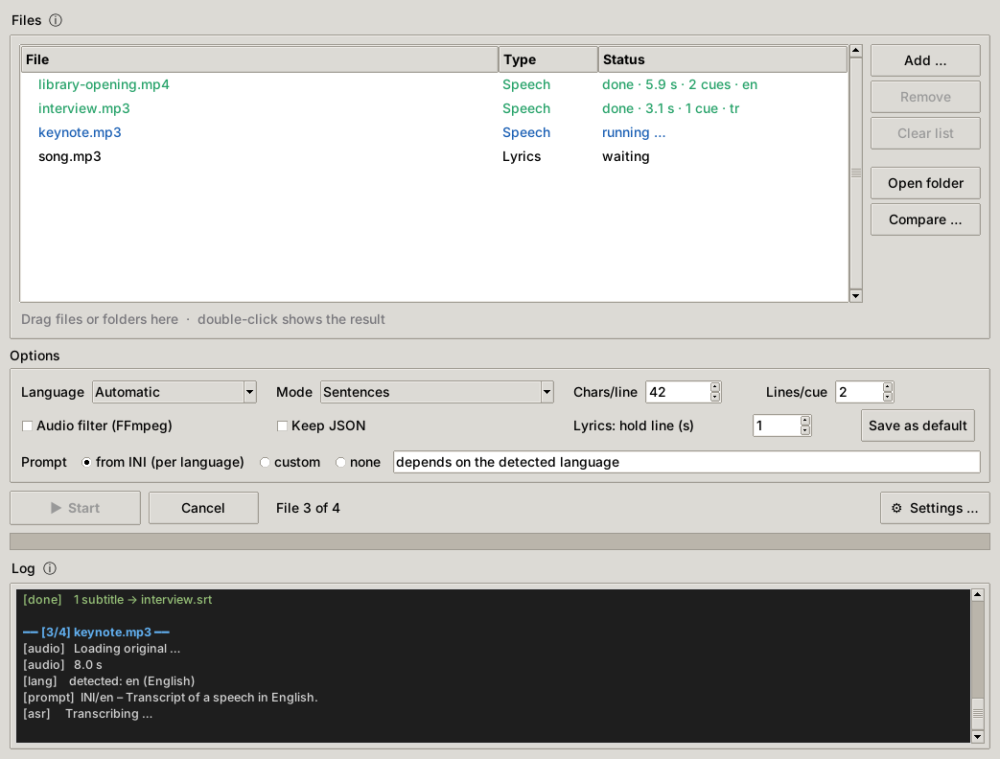
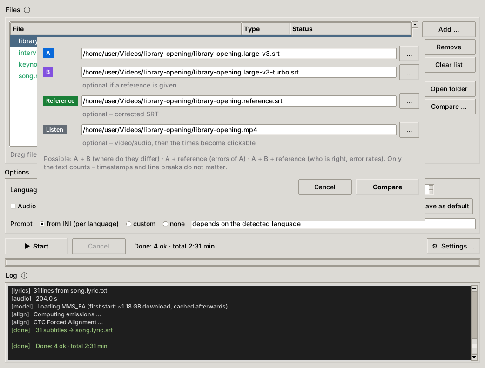
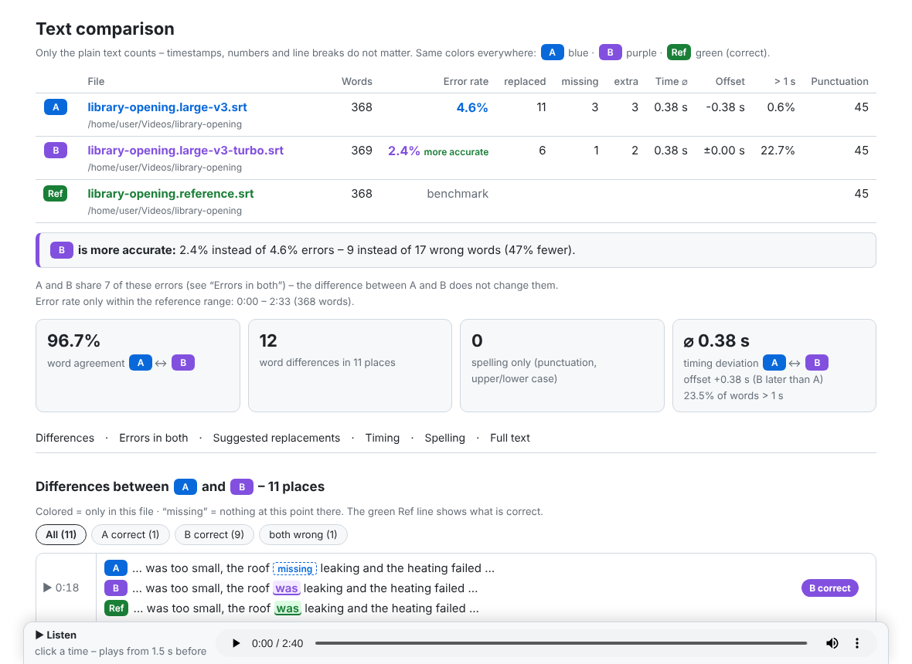
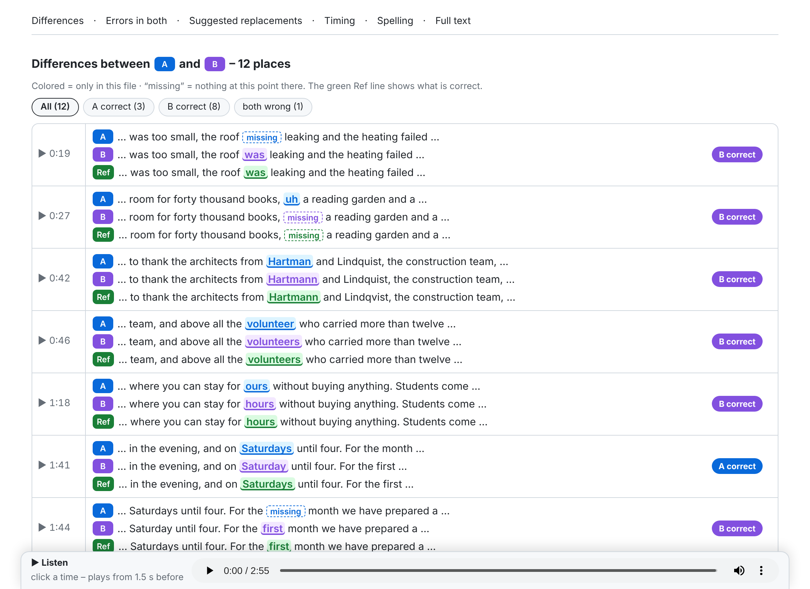
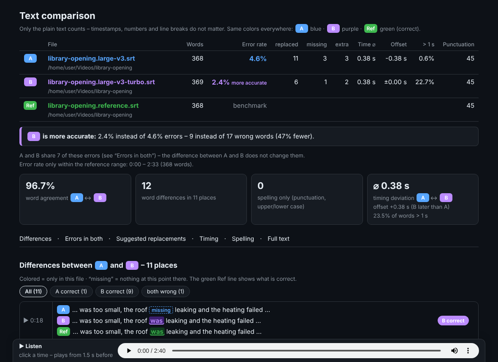
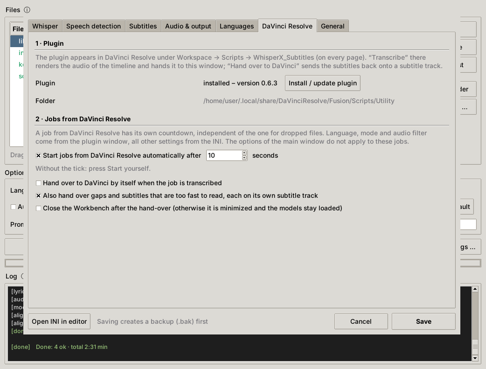
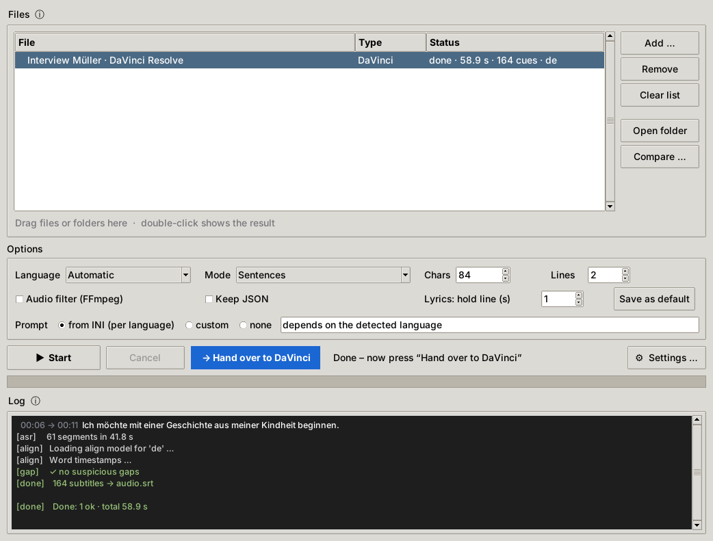
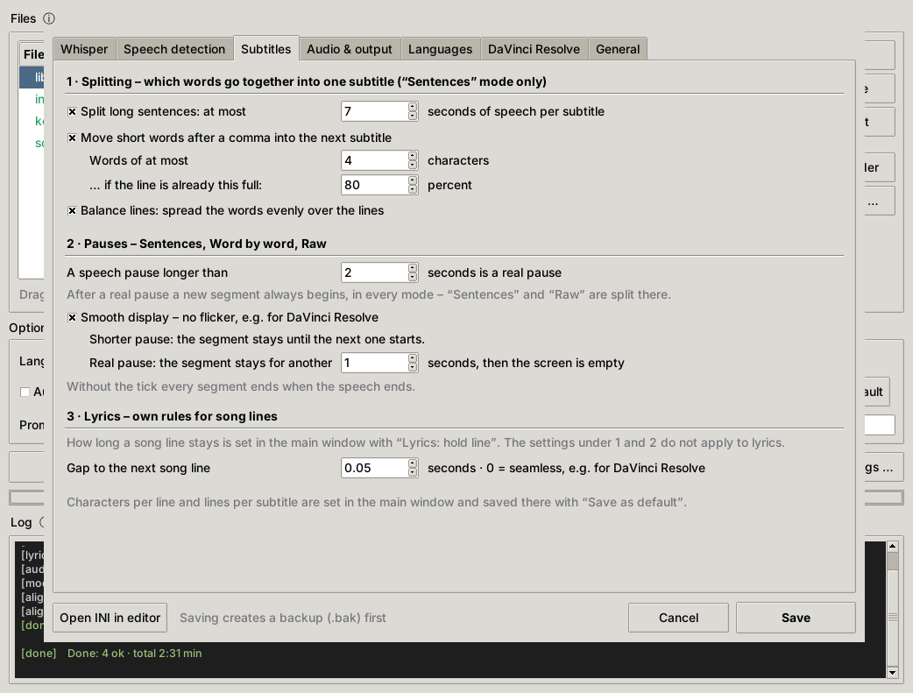
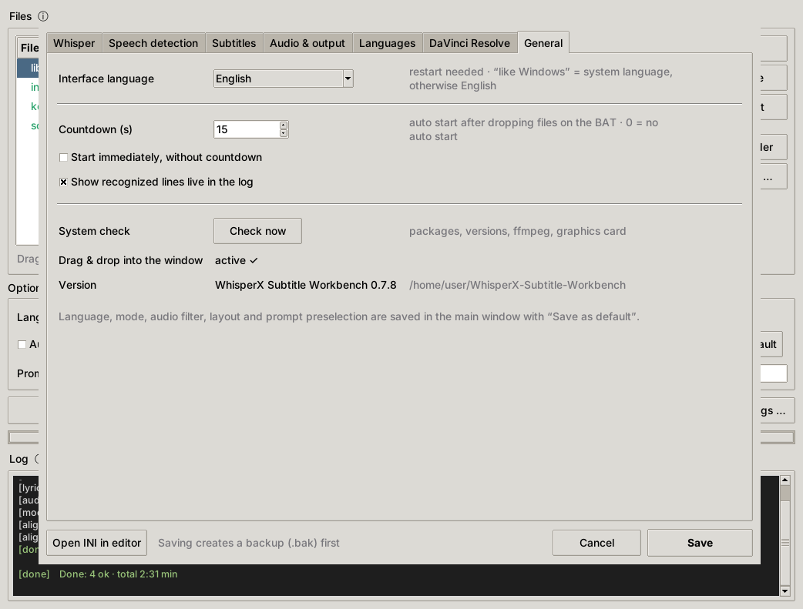

# WhisperX Subtitle Workbench

[English](README.md) · [Deutsch](README.de.md) · **Türkçe**

**Sürüm 0.6.3** · [Değişiklikler](CHANGELOG.md)

**Konuşmalardan altyazı** (WhisperX), **şarkıya göre hizalanmış şarkı sözleri** (MMS_FA) ve **transkriptlerin kelime kelime karşılaştırılması** için bir Windows programı. Buna bir **DaVinci Resolve eklentisi** de dahildir. Arayüz Türkçe, İngilizce ve Almanca olarak kullanılabilir.



Video veya ses dosyalarını pencereye sürüklersiniz, araç `.srt` altyazıları oluşturur. Altyazı kuralları okunabilir bir sonuç için ayarlanmıştır: satır uzunluğu, yetim kelimeler, sarkan kelimeler, uzun cümleler ve duraklamalar. Boşluk kontrolü metin almamış yüksek sesli yerleri bulur. Karşılaştırma raporu hangi modelin veya ayarın daha iyi tanıdığını gösterir: hata oranları, zaman sapmaları ve tıklanınca o yeri çalan zamanlarla. DaVinci Resolve eklentisiyle bir zaman çizelgesini doğrudan Resolve içinden yazıya dökersiniz; altyazılar bir altyazı izine yerleşir.

> Ekran görüntüleri İngilizce arayüzü gösterir; *Ayarlar → Genel* altında Türkçeye geçebilirsiniz.

---

## İçindekiler

- [Özellikler](#özellikler)
- [Gereksinimler ve bağımlılıklar](#gereksinimler-ve-bağımlılıklar) ← **kurulumdan önce okuyun**
- [Kurulum (Windows)](#kurulum-windows)
- [Güvenli güncelleme](#güvenli-güncelleme)
- [Kullanım](#kullanım)
- [Transkriptleri karşılaştırma](#transkriptleri-karşılaştırma)
- [DaVinci Resolve](#davinci-resolve)
- [Ayarlar](#ayarlar)
- [Arayüz dili ve çeviriler](#arayüz-dili-ve-çeviriler)
- [Komut satırı](#komut-satırı)
- [Sorun giderme](#sorun-giderme)
- [Proje yapısı](#proje-yapısı)
- [Lisans ve teşekkür](#lisans-ve-teşekkür)

---

## Özellikler

- **Konuşma → SRT**, WhisperX ile (faster-whisper + kelime zaman damgaları). Modeller dosyalar arasında yüklü kalır, bu yüzden ikinci dosya yükleme süresi olmadan başlar.
- **Üç altyazı modu:**
  - **Cümle cümle:** karakter sınırı ile yetim kelimeler, sarkan kelimeler, duraklamalar ve uzun cümle kurallarına göre tam cümleler.
    Süresine göre çok fazla metin içeren altyazıları (saniyede 17 karakterden fazla) günlük listeler.
    Satır dengeleme kelimeleri satırlara eşit dağıtır (`bunu hiç beklemiyorduk / ama` yerine `bunu hiç / beklemiyorduk ama`), mümkünse virgülden sonra bölerek.
    Kısaltmalar ve tarihler bir arada kalır: `Dr. Ayşe`, `örn. dün` ve `6. Kasım` asla iki satıra veya iki altyazıya bölünmez. Dile göre liste *Ayarlar → Diller* altındadır.
  - **Kelime kelime:** her kelime için bir altyazı, örn. karaoke efektleri için.
  - **Ham:** WhisperX bölümleri değiştirilmeden – yalnızca gerçek bir duraklamada bölünür.
- **Duraklamalar, DaVinci Resolve için titremesiz** (*Ayarlar → Altyazılar → Duraklamalar*): yalnızca duraklamanın uzunluğu önemlidir. Ayarlanan sınıra kadar (örn. 2 saniye) bir bölüm, bir sonraki başlayana kadar ekranda kalır; DaVinci'nin altyazı izi arada hiç boş an göstermez. Daha uzun, gerçek bir duraklamadan (alkış, müzik) sonra kısa bir tutma süresi kadar kalır, sonra ekran boş olur. Başlangıçlar tam kalır. Cümle cümle, Kelime kelime ve Ham için geçerlidir; şarkı sözlerinde *Sonraki şarkı satırına mesafe* değerini 0 yapın.
- **Dosya başına dil:** dil her dosya için algılanır ya da siz belirlersiniz. Her dilin kendi prompt'u, dolgu kelimeleri, sarkan kelimeleri, değiştirmeleri ve isteğe bağlı olarak kendi modeli vardır (örn. Türkçe ince ayarlı bir model).
- **Şarkı sözü modu:** `sarki.mp3` dosyasının yanına `sarki.lyric.txt` koyarsanız şarkı metninin her satırı sese göre zamanlanır. Bu, zorlamalı hizalama (MMS_FA + uroman) ile çalışır ve her dilde işler.
- **JSON → SRT:** WhisperX sonucunu saklayabilir ve altyazıları daha sonra saniyeler içinde farklı bir düzenle yeniden oluşturabilirsiniz.
- **Boşluk kontrolü:** her transkripsiyondan sonra metin almamış, yüksek sesli ve insan sesine benzeyen yerleri, yani kaçırılmış konuşmayı bulur. Ayrıca her yere doğrudan atlamanızı sağlayan bir altyazı dosyası yazar.
- **Karşılaştırma raporu** (HTML): A – B, A – referans veya A – B – referans.
  - Her farkta kimin haklı olduğunu gösterir.
  - Her dosyanın hata oranını (WER) ve iki dosyanın ortak hatalarını gösterir.
  - Değiştirmeler önerir.
  - Zaman sapmalarını gösterir.
  - Rapordaki her zaman tıklanabilir ve sesi o noktadan çalar.
- **DaVinci Resolve:** bir eklenti zaman çizelgesini doğrudan Resolve içinden yazıya döker; altyazılar yerel bir altyazı izine geri gelir (bkz. [DaVinci Resolve](#davinci-resolve)).
- **Sistem kontrolü** her başlatmada: Python'u, tüm paketleri sürümleriyle, ffmpeg'i, modelleri ve ekran kartını listeler ve hangi işlevin çalışmayacağını söyler.
- **Kolaylıklar:**
  - BAT dosyasına veya pencereye sürükle-bırak. İkinci bir başlatma, dosyalarını zaten açık olan pencereye aktarır.
  - Bir geri sayım işlemi otomatik olarak başlatır; DaVinci Resolve'dan gelen işlerin kendi geri sayımı vardır.
  - Tanınan satırlar günlükte canlı görünür.
  - İpuçları her seçeneği açıklar.
  - Ayarlar penceresi yalnızca değişen değerleri yazar ve INI'deki açıklamaları korur.
- **Çok dilli:** Türkçe, İngilizce ve Almanca. Tek bir JSON dosyasını kopyalayarak başka diller ekleyebilirsiniz (bkz. [Arayüz dili ve çeviriler](#arayüz-dili-ve-çeviriler)).

---

## Gereksinimler ve bağımlılıklar

> **Bu kılavuzun en önemli kısmı.** WhisperX; PyTorch, CTranslate2, pyannote ve birkaç küçük paketin üzerine kuruludur ve bunlar birbirlerinin **tam** sürümlerine bağlıdır. Dikkatsiz bir `pip install`, CUDA'lı PyTorch'unuzu sessizce CPU sürümüyle ya da uyumsuz bir sürümle değiştirebilir. Araç o zaman anlaşılması zor şekillerde hata verir. Aşağıdaki sıraya uyarsanız çalıştığı bilinen bir kombinasyon elde edersiniz.

### Neye ihtiyacınız var

| Ne | Test edilen | Not |
|---|---|---|
| Windows | Windows 10/11, 64 bit | Arayüz Tkinter'dır; çekirdek Linux'ta da çalışır, BAT başlatıcısı Windows içindir |
| NVIDIA ekran kartı | RTX 5080 (16 GB) | `large-v3` için ≥ 8 GB ekran kartı belleği önerilir. RTX 20xx veya daha yenisi; GTX 10xx ve daha eskileri başka bir PyTorch derlemesi gerektirir (4. adım). CPU ile de çalışır ama çok yavaştır |
| NVIDIA sürücüsü | R570 veya daha yeni | CUDA 12.8 paketleri için gerekli. Yalnızca sürücü yeterli; CUDA araç setini kurmanız **gerekmez** |
| Python | **3.10.11** (WhisperX 3.10–3.13'e izin verir) | python.org'dan, “tcl/tk and IDLE” (Tkinter) seçili olarak; bu varsayılan olarak işaretlidir. 3.10.11, Windows kurulum programı olan son 3.10 sürümüdür. Python 3.10 2026'dan beri güvenlik güncellemesi almıyor; paket kombinasyonu 3.10 ile test edilmiştir |
| ffmpeg | 6.x / 7.x | Ayrı bir program, pip paketi değil. Herhangi bir tam sürüm, örn. `winget install Gyan.FFmpeg` |
| İnternet | yalnızca ilk başlatmada | Whisper modeli (~3 GB), dile göre hizalama modelleri, MMS_FA (şarkı sözleri için ~1,2 GB) |

Hugging Face token'ı gerekmez, çünkü araç konuşmacı ayrımı (diarization) kullanmaz.

### Test edilmiş paket kombinasyonu

Bu sürümler gerçek kullanımda birlikte çalışıyor (Python 3.10, Windows 11, RTX 5080):

| Paket | Sürüm | Neden tam olarak bu |
|---|---|---|
| `torch` | **2.8.0+cu128** | WhisperX 3.8 `torch~=2.8.0` ister (yalnızca 2.8.x). **Mutlaka** PyTorch CUDA dizininden gelmeli; Windows için PyPI paketi yalnızca CPU sürümüdür. RTX 50xx (Blackwell, sm_120) cu128 veya daha yeni bir derleme gerektirir |
| `torchaudio` | **2.8.0+cu128** | torch ile **tam olarak** aynı sürüm ve aynı CUDA derlemesi olmalı. Şarkı sözleri (MMS_FA) için kullanılır |
| `torchvision` | 0.23.0 | torch 2.8'e aittir (WhisperX gerektirir) |
| `torchcodec` | 0.7.0 | WhisperX `<0.8`, pyannote-audio 4 `≥0.7` ister, yani yalnızca 0.7.x uyar. torch 2.8'e aittir |
| `whisperx` | **3.8.5** | Araç 3.8.x ile test edildi; sistem kontrolü 3.8'in altında uyarır |
| `faster-whisper` | 1.2.1 | `ctranslate2 <5` ister |
| `ctranslate2` | 4.7.1 | **4.5'ten** itibaren CUDA 12 + **cuDNN 9** kullanılır, bunu torch 2.8 birlikte getirir. 4.4 ve öncesi cuDNN 8 bekler ve başarısız olur |
| `pyannote-audio` | 4.0.4 | Konuşma algılama (VAD). torch ≥ 2.8 ve torchcodec ≥ 0.7 ister |
| `numpy` | ≥ 2.1 (WhisperX kurar) | `numpy<2` isteyen paketler aynı venv'de olamaz |
| `uroman` | 1.3.1.1 | Yalnızca şarkı sözü modu için (hizalama için Latin harflerine çevirme) |
| `tkinterdnd2` | 0.6.3, *isteğe bağlı* | Doğrudan pencereye sürükle-bırak. Bağımlılığı yoktur; `--no-deps` ile kurun |

### Bağımlılıklar nasıl birbirine bağlı

```
torch 2.8.0+cu128 ──┬── torchaudio 2.8.0+cu128   (her zaman aynı sürüm + aynı CUDA derlemesi)
                    ├── torchvision 0.23.0
                    ├── torchcodec 0.7.x          (WhisperX <0.8, pyannote ≥0.7)
                    └── cuDNN 9 (dahil) ───────── ctranslate2 ≥4.5 ── faster-whisper 1.2.x
                                                                    │
whisperx 3.8.x ── ister: torch~=2.8.0, torchaudio~=2.8.0, torchvision~=0.23.0,
                  torchcodec <0.8, ctranslate2 ≥4.5, faster-whisper ≥1.2, pyannote-audio ≥4, numpy ≥2.1
```

### Kurulumu bozmanın bilinen yolları

| Ne olur | Tipik belirti | Önleme / çözüm |
|---|---|---|
| torch'tan **önce** `pip install whisperx` | torch PyPI'dan CPU sürümü olarak gelir → sistem kontrolü: “torch, CUDA'sız bir sürüm” | Her zaman önce torch'u PyTorch dizininden kurun (aşağıda 4. adım) |
| `pip install -U whisperx` veya başka bir paket farklı bir torch çeker | torch/torchaudio değişir, şarkı sözleri veya VAD başarısız olur, CUDA gider | Önce `pip install --dry-run …` çalıştırın; `torch`, `torchaudio`, `torchvision`, `torchcodec` veya `ctranslate2` değişecekse iptal edin |
| torch ve torchaudio farklı sürüm veya derlemeden | torchaudio'da içe aktarma hataları (`DLL load failed`, `WinError 127`), şarkı sözleri başarısız olur; sistem kontrolü uyarır | İkisini aynı sürüm ve `--index-url` ile birlikte yeniden kurun |
| `ctranslate2` < 4.5 | `Could not locate cudnn_ops_infer64_8.dll` | ctranslate2 ≥ 4.5 kullanın (test edilen: 4.7.1) |
| RTX 50xx'te eski bir CUDA derlemesi (cu121/cu124) | `no kernel image is available for execution on the device` | cu128 derlemesini kullanın |
| GTX 10xx, GTX 9xx veya Titan V'de cu128 derlemesi | “… CUDA capability sm_61 is not compatible …” uyarısı, ardından `no kernel image is available` | cu126 derlemesini kullanın (4. adım) |
| Farklı bir torch içeren **mevcut** bir venv'de `pip install -r requirements.txt` | pip o torch'u PyPI'daki CPU sürümüyle değiştirir ve orada kurulu WhisperX de artık çalışmaz | Asla mevcut bir venv'e kurmayın; kendi venv'i olan yeni bir klasör kullanın |
| Başka bir yapay zekâ aracı aynı venv'e kuruldu | farklı torch veya `numpy<2` → çeşitli hatalar | Diğer araçlara kendi venv'lerini verin |
| Tkinter'sız Python | Araç “Tkinter eksik” der | Python kurulum programı → Modify → “tcl/tk and IDLE” |

---

## Kurulum (Windows)

Tüm komutlar `cmd.exe` içindir. Örnek klasör `C:\WhisperX-Subtitle-Workbench`. Başka bir klasör de olur, yeter ki `venv` onun **içinde** olsun; çünkü `Whisper_Tool.bat` onu orada arar.

**1. Python 3.10.11'i kurun**, [python.org](https://www.python.org/downloads/release/python-31011/) adresinden (*Windows installer (64-bit)*). Daha yeni 3.10 sürümleri yalnızca kaynak kod olarak, kurulum programı olmadan sunulur.

- “tcl/tk and IDLE” seçili kalsın.
- Zaten başka bir Python kullanıyorsanız “Add python.exe to PATH” seçeneğini **işaretlemeyin**. Bu kılavuzun buna ihtiyacı yoktur (`py -3.10`), ve diğer Python'unuz varsayılan olarak kalır.

**2. ffmpeg'i kurun**, örneğin:

```bash
winget install Gyan.FFmpeg
```

Ardından **yeni** bir `cmd` penceresi açın; winget'i çalıştırdığınız pencere yeni yolu henüz bilmez. İsterseniz bir sürümü `C:\ffmpeg` klasörüne açıp daha sonra *Ayarlar → Ses ve çıktı* altında `C:\ffmpeg\bin\ffmpeg.exe` yolunu da girebilirsiniz.

**3. Workbench'i edinin**, git ile ya da ZIP'i GitHub'dan indirip açarak:

```bash
git clone https://github.com/fardem/WhisperX-Subtitle-Workbench C:\WhisperX-Subtitle-Workbench
```

ZIP, `WhisperX-Subtitle-Workbench-main` adlı bir klasöre açılır. Adını `WhisperX-Subtitle-Workbench` olarak değiştirin veya aşağıdaki komutlarda yolu uyarlayın.

**4. venv oluşturun ve PyTorch'u CUDA ile kurun.** Bu adım önce gelir ve belirleyici olandır.

Önce sürücüyü kontrol edin. `nvidia-smi` en üstte *Driver Version* değerini gösterir; 570 veya daha yüksek olmalıdır:

```bash
nvidia-smi
```

```bash
cd /d C:\WhisperX-Subtitle-Workbench
```

```bash
py -3.10 -m venv venv
```

```bash
venv\Scripts\python.exe -m pip install --upgrade pip
```

```bash
venv\Scripts\python.exe -m pip install torch==2.8.0 torchaudio==2.8.0 torchvision==0.23.0 --index-url https://download.pytorch.org/whl/cu128
```

> **Hangi ekran kartı için hangi derleme:**
> - RTX 50xx için `cu128` gerekir.
> - RTX 20xx ile 40xx arası `cu128` ile çalışır.
> - GTX 10xx, GTX 9xx ve Titan V artık cu128 derlemesi tarafından **desteklenmiyor**. Yukarıdaki komutun sonunda `cu128` yerine `cu126` yazın; 6. adım o zaman `2.8.0+cu126 12.6 True` gösterir. GTX 10xx kartlarında ayrıca hızlı float16 yoktur, bu yüzden *Ayarlar → Whisper → Hassasiyet* değerini `int8` veya `float32` yapın.
>
> Yalnızca RTX 5080 üzerinde cu128 derlemesi test edilmiştir.

**5. WhisperX'i ve gerisini kurun**, test edilmiş sürümlerle:

```bash
venv\Scripts\python.exe -m pip install -r requirements.txt -c constraints.txt
```

`requirements.txt` *neyin* kurulacağını söyler. `constraints.txt` ise dolaylı olarak gelen yaklaşık 100 paket dahil **tüm** paketleri, test edilmiş kurulumdaki sürümlere sabitler. Böylece bir paket daha sonra yeni bir sürüm çıkarsa bile yeni bir kurulum test edilmiş olanla aynı olur. pip mevcut `torch 2.8.0+cu128` sürümünü korur, çünkü bu sürüm WhisperX'in `torch~=2.8.0` şartını zaten karşılar.

**6. Kurulumu kontrol edin:**

```bash
venv\Scripts\python.exe -c "import torch; print(torch.__version__, torch.version.cuda, torch.cuda.is_available())"
```

Beklenen çıktı `2.8.0+cu128 12.8 True`. Ardından venv'i çakışmalara karşı kontrol edin:

```bash
venv\Scripts\python.exe -m pip check
```

**7. İsteğe bağlı: doğrudan pencereye sürükle-bırak.** Bunu daha sonra *Ayarlar → Genel* altında tek tıkla da yapabilirsiniz:

```bash
venv\Scripts\python.exe -m pip install --no-deps tkinterdnd2==0.6.3
```

**8. Başlatın:** `Whisper_Tool.bat`. İlk başlatmada araç `whisper_tool.example.ini` dosyasından `whisper_tool.ini` oluşturur ve sistem kontrolünü çalıştırır. Kontrolün her satırı yeşil olmalıdır.

**Masaüstü kısayolu:** `Whisper_Tool.bat` üzerinde sağ tık → *Kısayol oluştur* → kısayolu masaüstüne taşıyın. Dosyaları ve klasörleri kısayolun üzerine sürükleyebilirsiniz.

### Mevcut bir WhisperX venv'ini kullanma

Çalışan bir WhisperX venv'iniz zaten varsa, örn. `C:\WhisperX\venv`, bu deponun dosyalarını `C:\WhisperX` klasörüne, `venv` klasörünün yanına kopyalayın. Hiçbir şey kurulmaz; araç yalnızca zaten var olan paketleri kullanır. Kopyalamadan önce aracı kapatın ve dosyaları bir alt klasöre değil, doğrudan `C:\WhisperX` içine çıkarın.

> **Bu venv'de `pip install` çalıştırmayın, özellikle de `requirements.txt` ile.** Orada 2.8.x dışında bir torch kuruluysa pip onu PyPI'daki CPU sürümüyle değiştirir ve mevcut WhisperX'iniz de artık çalışmaz. Sistem kontrolü WhisperX'i çok eski olarak bildirirse, Workbench'i bunun yerine kendi venv'i olan **yeni bir klasöre** kurun (1–8. adımlar). Eski kurulumunuza dokunulmaz.

---

## Güvenli güncelleme

- **Önce aracı kapatın.** Çalışan sürüm başlık çubuğunda (örn. *WhisperX Subtitle Workbench 0.6.3*), günlüğün ilk satırında ve *Ayarlar → Genel* altında görünür. Yeni sürümü başlattığınızda daha eski bir pencere hâlâ açıksa, yeni sürüm dosyalarınızı sessizce eski pencereye aktarmak yerine sizi uyarır.
- **Workbench'in kendisi:** `git pull`, ya da yeni dosyaları eskilerin üzerine kopyalayın. Ayarlarınız `whisper_tool.ini` dosyasındadır. Bu dosya depoya ait değildir, bu yüzden bir güncelleme onun üzerine asla yazmaz. Yeni seçenekler otomatik olarak varsayılan değer alır.
- **Python paketleri:** yalnızca yeni bir şeye ihtiyacınız olduğunda güncelleyin. Güvenli yol şöyledir:

1. **venv'i yedekleyin:** aracı kapatın ve tüm `venv` klasörünü kopyalayın, örn. `venv-backup` olarak. Asıl yedek budur. Geri almak için `venv` klasörünü silin ve `venv-backup` adını yeniden `venv` yapın. Yalnızca orijinal yolunda çalışır.

2. Daha sonra bakabilmek için mevcut durumu not edin:

   ```bash
   venv\Scripts\python.exe -m pip freeze > requirements-working.txt
   ```

   Bu liste `torch==2.8.0+cu128` içerir ve bu sürüm PyPI'da yoktur. Listeden **yeni** bir venv'e kurmak için pip'in ayrıca PyTorch dizinine ihtiyacı vardır:

   ```bash
   venv\Scripts\python.exe -m pip install -r requirements-working.txt --extra-index-url https://download.pytorch.org/whl/cu128
   ```

3. Önce bir deneme çalıştırması yapın. Hiçbir şey kurmaz:

   ```bash
   venv\Scripts\python.exe -m pip install --dry-run -U whisperx
   ```

4. Deneme çıktısında “Would install” altında `torch`, `torchaudio`, `torchvision`, `torchcodec` veya `ctranslate2` görünüyorsa **iptal edin**. Bu güncelleme kombinasyonu bozardı.

---

## Kullanım

| Sürüklediğiniz … | Aracın yaptığı … | Sonuç |
|---|---|---|
| bir video/ses dosyası (`.mp4 .mkv .mp3 .wav .m4a …`) | WhisperX ile transkripsiyon | `<name>.srt` |
| yanında `<name>.lyric.txt` olan bir medya dosyası | şarkı sözü hizalama (her satıra bir şarkı satırı, UTF-8) | `<name>.lyric.srt` |
| bir WhisperX `.json` dosyası (“JSON'u sakla” ile kaydedilmiş) | yalnızca altyazıları yeniden oluşturur | `<name>.srt` |
| bir klasör | içindeki tüm medya dosyaları | |
| bir DaVinci Resolve işinin WAV dosyası – eklenti aracı bununla başlatır | yazıya dökme, ardından **→ DaVinci'ye aktar** | altyazılar Resolve'da bir altyazı izinde |

- **Başlat** seçili dosyaları işler. Seçim yoksa henüz bitmemiş tüm dosyaları işler. Hepsi bittiyse hepsini yeniden işler, örn. farklı bir düzenle.
- **Dil:**
  - *Otomatik*, dili her dosya için ilk 30 saniyeye göre algılar.
  - Sabit bir dil daha güvenilirdir. Kayıt müzikle veya bir girişle başlıyorsa onu seçin.
- **Prompt:** Whisper'a nadir isim ve terimleri istenen yazımla veren kısa bir ipucu. Sesin dilinde yazın. Her dilin prompt'unu *Ayarlar → Diller* altında ayarlarsınız.
- **Boşluk kontrolü:**
  - Şüpheli boşlukları olan dosyalar listede “⚠ boşluk” durumunu alır.
  - Bu yerler günlükte sarı görünür.
  - Ayrıca `<name>.bosluklar.srt` olarak kaydedilir. Dosya adı arayüz diline göre değişir: İngilizcede `.gaps.srt`, Almancada `.luecken.srt`. Her yere atlamak için VLC'de veya Subtitle Edit'te ikinci altyazı izi olarak yükleyin.
- **Fareyi herhangi bir öğenin üzerinde tutarsanız** ayrıntılı bir açıklama görünür.

---

## Transkriptleri karşılaştırma

Modelleri ve ayarları test etmek için dosya listesindeki **Karşılaştır …** düğmesini kullanın. Yalnızca düz metin sayılır; zaman damgaları ve satır sonları yok sayılır.



| Dosyalar | Ne öğrenirsiniz |
|---|---|
| **A + B** | İki transkriptin nerede farklı olduğunu, örn. iki model, beam veya prompt |
| **A + referans** | A'nın tüm hatalarını. Referans, elle düzeltilmiş bir SRT'dir; 5–10 düzeltilmiş dakika yeterlidir |
| **A + B + referans** | Her farkta kimin haklı olduğunu, iki dosyanın hata oranını, ortak hataları ve değiştirme önerilerini |

Renkler her yerde aynıdır: **A mavi, B mor, referans yeşil (doğru)**. Hiçbir şeyin üzeri çizilmez; *eksik*, bir dosyada hiçbir şey olmayan yeri işaretler.





Rapor ayrıca şunları içerir:
- **Zaman:** tipik sapma ve medyan kayma, her zaman gösterilir. Art arda birkaç kelimenin 1 sn'den fazla saptığı bölümler ayrıca listelenir.
- **İkisinde de hata:** yalnızca bir prompt'un veya bir değiştirmenin düzeltebileceği hatalar.
- **Değiştirme önerileri:** kopyalama düğmeli `yanlış = doğru` satırları, *Ayarlar → Diller → Değiştirmeler* için hazır.
- **Yalnızca yazım:** noktalama veya büyük/küçük harf farkları; hata sayılmaz.
- **Tam metin:** tüm farkları işaretlenmiş metnin tamamı.

**Dinle:** video veya sesi de verirseniz araç, raporun yanına küçük bir ses izi (`.m4a`) koyar. Rapordaki her zaman o zaman tıklanabilir olur ve yeri 1,5 sn önceden çalar. Raporu ve `.m4a` dosyasını birlikte tutun.

İpucu: *Konuşma uzantısı*nı `.{model}.srt` olarak ayarlayın (*Ayarlar → Ses ve çıktı*). O zaman her model kendi SRT'sini yazar ve karşılaştırması kolaylaşır.

Rapor, sisteminizin açık/koyu moduna uyar:



---

## DaVinci Resolve

Bir eklenti, Workbench'i **DaVinci Resolve Studio** ile bağlar: Resolve zaman çizelgesinin sesini render eder, Workbench her zamanki gibi yazıya döker ve altyazılar **yerel bir altyazı izine** geri gelir – Text+ başlıkları olarak değil. Altyazıları doğrudan Resolve'da düzeltir, kendi araçlarınızla biçimlendirmeye devam edersiniz. Eklenti kendi başlık efektlerini getirmez.

### Eklentiyi kurma

1. Workbench'te: *Ayarlar → DaVinci Resolve → Eklentiyi kur / güncelle*. Bu, `WhisperX_Subtitles.lua` dosyasını `%APPDATA%\Blackmagic Design\DaVinci Resolve\Support\Fusion\Scripts\Utility\` klasörüne yazar; böylece eklenti Resolve'un her sayfasında listelenir. Workbench'in klasörü, arayüz dili ve eklentinin tüm metinleri dosyaya yazılır – ayarlanacak bir şey yoktur.
2. Resolve'da: *Workspace → Scripts → WhisperX_Subtitles*. Orada görünmüyorsa Resolve'u bir kez yeniden başlatın.

Workbench'i güncelledikten, klasörünü taşıdıktan ve arayüz dilini değiştirdikten sonra eklentiyi yeniden kurun; sekme, kurulu eklentinin güncel olup olmadığını gösterir.



> Workbench'in yolu yalnızca düz ASCII karakterler içerebilir, örn. `C:\WhisperX-Subtitle-Workbench` – ü, ş, ğ gibi harfler olmadan. Resolve'un Lua'sı Windows'ta başka yollardaki dosyaları açamaz; kurulum bu durumda kurmak yerine bunu bildirir.

### İş akışı

1. Zaman çizelgesini Resolve'da açın. Yalnızca bir bölüm yazıya dökülecekse In ve Out koyun, yoksa tüm zaman çizelgesi kullanılır. Eklentiyi başlatın, gerekirse bu iş için **Dil** ve **Mod** seçin (“Workbench varsayılanı” INI'deki varsayılanı kullanır), **Ses filtresi**ni açın veya kapatın ve **Yazıya dök** düğmesine basın. Eklenti penceresi konumunu, boyutunu ve bu üç seçimi hatırlar.
2. Eklenti, zaman çizelgesinin ana miksini WAV olarak Workbench'in `resolve_temp\<iş>\` klasörüne render eder. Ardından render işi silinir; sayfa, Deliver ayarları ve In/Out işaretleri eskisi gibidir – bir hatadan veya *İptal*'den sonra da. Sonra Workbench'i WAV ile başlatır; zaten açık olan bir Workbench dosyayı devralır, modelleri yüklü kalır.
3. Workbench'te iş “*Zaman çizelgesi* · DaVinci Resolve” olarak listede görünür. Kendi geri sayımı vardır (*Ayarlar → DaVinci Resolve*, varsayılan 10 saniye). Dil, mod ve ses filtresi eklenti penceresinden, diğer tüm ayarlar INI'den gelir: prompt, satır başına karakter ve satır sayısı ile *Ayarlar → Altyazılar*'daki tüm kurallar. Ana penceredeki seçenekler DaVinci işleri için geçerli değildir. Günlük ikisini de gösterir. Geri sayım kapalıysa *Başlat*'a kendiniz basarsınız. Bu sırada eklenti penceresi işin nerede olduğunu gösterir: geri sayım, yüzde olarak transkripsiyon, bitti.
4. İş bitince altyazıları kontrol edin ve **→ DaVinci'ye aktar** düğmesine basın (iş bitince mavi olur). SRT, zaman çizelgesindeki aralığın konumuna kaydırılır ve `resolve_temp\<ZamanÇizelgesi>_<DİL>_<tarih-saat>.srt` olarak kaydedilir; bu klasör son 10 aktarımın SRT'lerini saklar, 11. aktarım en eskisini siler. Ad her seferinde yenidir, çünkü Resolve medya havuzunda zaten bulunan bir dosyayı yeniden okumaz – ilk içe aktarmanın altyazılarını yerleştirirdi. Ardından Workbench kendini simge durumuna küçültür – açık kalır, modelleri bir sonraki iş için yüklü kalır. *Ayarlar → DaVinci Resolve* altında iş yazıya dökülür dökülmez otomatik aktarımı ve küçültmek yerine kapatmayı açabilirsiniz.
5. Resolve'da bekleyen eklenti işin zaman çizelgesine geri döner, SRT'yi medya havuzundaki *WhisperX* klasörüne aktarır ve **ilk boş altyazı izine** (ST1, ST2, …) – ya da yeni bir ize – yerleştirir. İzin adı `WhisperX DE` olur (bu ad varsa `WhisperX DE 2`) ve etkin altyazı izi olarak kalır. Ardından WAV ve iş klasörü silinir; eklenti penceresi sonuçla öne gelir ve *Tamam*'a basana kadar orada kalır.
6. Açıksa (varsayılan) iki ek altyazı izi kontrole yardım eder: **WhisperX boşluklar** boşluk kontrolünden metinsiz yüksek sesli yerleri, **WhisperX çok hızlı** saniyede 17 karakterden fazla olan altyazıları işaretler (*Cümle cümle* modu). Resolve'da bunlar arasında gezinin, sonra iki izi silin. Transkript izi etkin iz olarak kalır.



Eklentideki **SRT içe aktar …** herhangi bir SRT'yi, örneğin bir çeviriyi, aynı şekilde bir altyazı izine yerleştirir. Dosyanın `resolve_temp\` içinde yeni adlı bir kopyasını içe aktarır; böylece arada düzeltilmiş bir dosya yeniden okunur. İz adı için dil dosya adından alınır (`…_EN.srt`), yoksa eklenti sorar. Dosya penceresi `resolve_temp\` klasöründe açılır.

Eklenti beklerken Resolve kullanılabilir kalır. Yazıya dökülen aralıkta zaman çizelgesinde yapılan değişiklikler altyazıların artık uymamasına yol açabilir; zaman çizelgesinin sonu değiştiyse eklenti içe aktarmadan önce sorar. Her adım *Workspace → Console* altında kaydedilir (`[WhisperX]` ile başlayan satırlar) – bir şey çalışmazsa bu çıktı yardımcı olur.

### Bilinen sınırlar

- DaVinci Resolve **Studio** 21.1.2 ve 21.2.0.5 ile Windows'ta test edildi. Resolve 21.1'in ücretsiz sürümü betiklerin dosya erişimini engeller; orada yalnızca *SRT içe aktar …* çalışır.
- Resolve bir SRT'yi yalnızca **etkin** altyazı izine yerleştirir ve aynı anda yalnızca biri etkin olabilir. Bu yüzden eklenti diğer altyazı izlerini devre dışı bırakır; sonrasında yeni iz etkin olandır. Boş ama kilitli bir iz atlanır.
- Altyazılar zaman çizelgesinin başına göre, yani In noktası kadar kaydırılarak yerleştirilir. Başlangıç zaman kodunun (örn. 01:00:00:00) da eklenmesi gerekip gerekmediği hâlâ test ediliyor; eklenti ilk altyazının konumunu beklenen kareyle karşılaştırır ve farkı bildirir.
- *Yazıya dök*'ten önce ve içe aktarma sırasında oynatmayı durdurun – oynatma sırasında sayfa değişirse Resolve takılabilir.
- Medya havuzundaki öğe `resolve_temp\` içindeki SRT'yi gösterir; dosya son 10 aktarımın en eskisi olarak silindiğinde öğe çevrimdışıdır. Zaman çizelgesindeki altyazılar projenin bir parçasıdır.
- `resolve/tools/probe_subtitles.lua`, yeni bir Resolve sürümünün SRT'yi nasıl yerleştirdiğini kontrol eder – bir Resolve güncellemesinden sonra çalıştırın.

---

## Ayarlar

- **Ana pencere:** dil, mod, düzen, ses filtresi ve prompt. *Varsayılan olarak kaydet* bunları INI'ye yazar.
- **Ayarlar …** yedi sekmeden oluşur: Whisper, Konuşma algılama, Altyazılar, Ses ve çıktı, Diller, DaVinci Resolve ve Genel. *Kaydet* yalnızca değişen değerleri `whisper_tool.ini` dosyasına yazar, önce bir `.bak` yedeği oluşturur ve tüm açıklamaları korur.
- `whisper_tool.ini` elle de düzenlenebilir. Her değerin açıklaması vardır; şablon `whisper_tool.example.ini` dosyasıdır.

*Ayarlar → Altyazılar*, aracın sırayla yanıtladığı sorulara göre düzenlenmiştir: **1 · Bölme** – hangi kelimeler birlikte bir altyazıya girer, **2 · Duraklamalar** – bir bölüm ekranda ne kadar kalır, **3 · Şarkı sözleri** – şarkı satırları için ayrı kurallar.



Değişiklikler pencereyi kapatmadan bir sonraki başlatmada geçerli olur. Modeller yalnızca bir model parametresi değiştiğinde yeniden yüklenir.

---

## Arayüz dili ve çeviriler

Arayüz, günlük ve karşılaştırma raporu **Türkçe, İngilizce ve Almanca** olarak kullanılabilir.



- *Ayarlar → Genel → Arayüz dili*. Varsayılan “Windows gibi”, bir dil dosyası varsa sistem dilini, yoksa İngilizceyi kullanır. Bir değişiklikten sonra araç pencereyi yeniden başlatmayı önerir.
- INI'de: `[System] ui_language = auto | en | de | tr`.

**Dil ekleme:**
1. `lang/en.json` dosyasını `lang/<kod>.json` olarak kopyalayın, örn. `lang/fr.json`.
2. Değerleri çevirin ve `"_meta" → "name"` alanını ayarlayın. `{n}` ve `{path}` gibi yer tutucuları değiştirmeyin.
3. Aracı yeniden başlatın. Yeni dil listede otomatik olarak görünür.

Eksik girdiler İngilizceye döner, bu yüzden yarım kalmış bir çeviri aracı asla bozmaz. Yeni dillerle pull request'ler memnuniyetle karşılanır.

---

## Komut satırı

Pencere olmadan, örn. zamanlanmış bir görev için, INI'deki `[Menu]` varsayılanlarıyla:

```bash
venv\Scripts\python.exe whisper_tool.py --nogui dosya1.mp4 dosya2.mp3
```

Pencere olmadan karşılaştırma raporu oluşturmak için:

```bash
venv\Scripts\python.exe wt_compare.py A.srt B.srt referans.srt --media video.mp4
```

```bash
venv\Scripts\python.exe wt_compare.py A.srt --ref referans.srt --lang tr
```

---

## Sorun giderme

| Sorun | Çözüm |
|---|---|
| Güncellemeden sonra hâlâ eski arayüz görünüyor (başlık “Whisper Tool”) | Eski bir pencere hâlâ açık ve başlatmayı devraldı. Kapatın – görünmüyorsa Görev Yöneticisi'nde `pythonw.exe`'yi sonlandırın – ve yeniden başlatın |
| Araç başlamıyor | Bir mesaj kutusu nedeni gösterir. Aynı metin `whisper_tool_error.log` dosyasında da bulunur |
| Sistem kontrolünde bir satır kırmızı | Eksik parçayı ve hangi işlevin etkilendiğini söyler. Bkz. [Kurulumu bozmanın bilinen yolları](#kurulumu-bozmanın-bilinen-yolları) |
| “torch, CUDA'sız bir sürüm” | torch PyPI'dan kurulmuş. Kurulumun 4. adımını tekrarlayın |
| Kısık sesli yerlerde metin eksik | Boşluk kontrolüne bakın. Sonra *Onset*'i düşürün veya *silero*'yu deneyin (*Ayarlar → Konuşma algılama*) |
| Tüm dosya için yanlış dil | *Otomatik* yerine dili belirleyin; baştaki müzik veya giriş algılamayı yanıltabilir |
| Prompt kelimeleri sessizlikte veya müzikte çıkıyor | Prompt'u kısaltın veya bu dosya için *yok*'u seçin |
| Eklenti Resolve'da *Workspace → Scripts* altında yok | Resolve'u bir kez yeniden başlatın; olmazsa eklentiyi *Ayarlar → DaVinci Resolve* altında yeniden kurun |
| Eklenti Workbench'in bulunamadığını söylüyor | Workbench klasörü taşınmış – eklentiyi yeniden kurun |
| Altyazılar Resolve'da yanlış yerde | *Workspace → Console* altındaki çıktıyı gönderin (`[WhisperX]` ile başlayan satırlar) |
| Pencereye sürükle-bırak çalışmıyor | *Ayarlar → Genel → Sürükle-bırak → Etkinleştir …*, sonra pencereyi yeniden başlatın. BAT üzerine sürüklemek her zaman çalışır |

---

## Proje yapısı

| Dosya | Görevi |
|---|---|
| `whisper_tool.py` | Arayüz (Tkinter), ayarlar penceresi, karşılaştırma penceresi, konsol modu |
| `wt_core.py` | Ses yükleme, WhisperX, şarkı sözü hizalama, altyazı kuralları, boşluk kontrolü, sistem kontrolü, INI yazıcı |
| `wt_compare.py` | Kelime kelime karşılaştırma ve HTML raporu (tek başına da kullanılabilir) |
| `wt_i18n.py` | Dil dosyalarını yükler |
| `wt_resolve.py` | DaVinci Resolve bağlantısı: iş ve sonuç dosyaları, SRT kaydırma, eklenti kurulumu |
| `resolve/WhisperX_Subtitles.lua` | DaVinci Resolve eklentisi (şablon; *Ayarlar → DaVinci Resolve* kurar) |
| `resolve/tools/probe_subtitles.lua` | Test betiği: Resolve bir SRT'yi altyazı izine nasıl yerleştirir |
| `wt_version.py` | Ad ve sürüm numarası (başlık çubuğunda, günlükte ve raporda görünür) |
| `lang/*.json` | Arayüzün, günlüğün ve raporun tüm metinleri (en, de, tr) |
| `whisper_tool.example.ini` | Ayar şablonu; ilk başlatmada `whisper_tool.ini` olarak kopyalanır |
| `Whisper_Tool.bat` | Başlatıcı: çift tıklayın veya dosyaları üzerine sürükleyin |
| `requirements.txt` | Test edilmiş paket sürümleri (önce torch'u kurun!) |
| `constraints.txt` | Test edilmiş kurulumdaki tüm paketlerin tam sürümleri (`pip freeze`), 5. adımda `-c` ile kullanılır |
| `tests/` | Otomatik testler (pytest). Ekran kartı veya WhisperX gerektirmez, GitHub'da her push'ta çalışır. Resolve eklentisinin testleri taklit bir Resolve'a karşı çalışır ve `lupa` paketini gerektirir; o yoksa atlanır |
| `resolve_temp/` | Eklentinin iş klasörleri ve son 10 aktarımın SRT'leri (depoda değil) |

---

## Lisans ve teşekkür

[MIT Lisansı](LICENSE) © 2026 fardem

Bu araç başkalarının emeği üzerine kuruludur:
- [WhisperX](https://github.com/m-bain/whisperX)
- [faster-whisper](https://github.com/SYSTRAN/faster-whisper) ve [CTranslate2](https://github.com/OpenNMT/CTranslate2)
- [OpenAI Whisper](https://github.com/openai/whisper)
- [pyannote.audio](https://github.com/pyannote/pyannote-audio)
- [PyTorch / torchaudio](https://pytorch.org/), MMS_FA zorlamalı hizalama hattı dahil
- [uroman](https://github.com/isi-nlp/uroman)
- [AutoSubs](https://github.com/tmoroney/auto-subs) (MIT) – Resolve'dan ses dışa aktarımı, eklentinin render bölümüne örnek oldu (kendi kodumuz)
- [FFmpeg](https://ffmpeg.org/)

Bu paketler için kendi lisansları geçerlidir. Ekran görüntüleri uydurma demo içerik gösterir.
